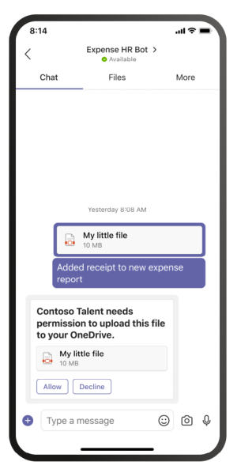

# Send and receive files

Agents can receive, read, and send documents in Microsoft Teams conversations. Teams stores these files in OneDrive or SharePoint and displays them as file cards or stored items.

Use Teams SDK to receive files in personal chats and send files through bot file consent. Use Microsoft Graph when your agent must work with stored files across personal chats, group chats, and channels. For images that render directly in a conversation, see [Send and receive inline images](agents-inline-images.md).

> [!IMPORTANT]
>
> Agents don't support document-file send and receive workflows in Government Community Cloud High (GCC High), Department of Defense (DoD), or Teams operated by 21Vianet.

## User experience

Understand how users exchange documents with an agent so you can provide clear prompts, consent requests, and confirmations. Users can:

* Attach a document to a personal chat with an agent.
* Review and accept or decline a file that an agent offers.
* Open a successfully uploaded file from its file card.
* Work with stored OneDrive or SharePoint files across supported conversation scopes.

A received document is stored in OneDrive or SharePoint and appears as a file card or stored item. A bot that sends a file in personal chat first asks for consent, uploads the file after acceptance, and then sends a file information card.

## Developer experience

Choose a file API based on the app identity, direction, and conversation scope. The following options match the implementation order in this article:

| Requirement | Recommended approach |
| --- | --- |
| Receive and read a document in a personal chat | Teams SDK file accessor |
| Send or retrieve stored files across conversation scopes | Microsoft Graph |
| Send a document from a bot in a personal chat | Teams SDK file consent |

The Teams SDK file accessor filters the activity attachment collection and exposes supported documents as lazy incoming-file handles. Agentic users retrieve file bytes through Microsoft Graph with their identity. Traditional bots use the short-lived, pre-authorized URL supplied by Teams.

| Operation | Personal chat | Group chat | Channel | Requirement |
| --- | --- | --- | --- | --- |
| Receive files with the Teams SDK file accessor | Supported | Not explicitly supported | Not explicitly supported | Agentic users require Graph file permissions. Bots use a pre-authorized URL. |
| Send or retrieve files with Graph | Supported | Supported | Supported | Configure permissions for the storage location, API, calling identity, and access model. |
| Send files with bot file consent | Supported | Not supported | Not supported | Set `supportsFiles` to `true` on the bot entry. |

## Receive files

Receive document files that users attach to personal chats so your agent can inspect or process their content. Configure file access first, then use the Teams SDK file accessor to list and read each received file.

### Configure file support

Configure file support so your agent or bot has the permissions and platform settings required to receive documents. Complete the setup for your app identity before implementing file handlers.

The required configuration depends on the identity and file operation:

| Scenario | App manifest update | Other configuration |
| --- | --- | --- |
| Agentic user receives a file | None | Add a Microsoft Graph file permission to the agent blueprint and obtain administrator consent. |
| Bot receives or sends a file through file consent | Set `supportsFiles` to `true` on the bot entry. | None for the pre-authorized file URL supplied by Teams. |
| App sends or retrieves a stored file with Microsoft Graph | No file-specific app manifest property | Configure the required Microsoft Graph permission and authentication for the calling identity. |

#### Agentic user

For an agentic user, you don't need to set `supportsFiles` or add another file-specific app manifest property. Configure a Microsoft Graph file permission on the agent blueprint and obtain administrator consent. The agentic user retrieves file content through Microsoft Graph with its own identity. For more information, see [inheritable permissions](/entra/agent-id/concept-inheritable-permissions).

> [!IMPORTANT]
>
> Configure and consent the blueprint permission before testing file retrieval. Without a Graph credential, the SDK raises a file credential error.

#### Bot

For a bot that receives files or uses file consent, set `supportsFiles` to `true` in the bot entry of the app manifest:

```json
{
  "bots": [
    {
      "botId": "${{BOT_ID}}",
      "scopes": ["personal"],
      "supportsFiles": true
    }
  ]
}
```

Key values:

* `botId`: Set `${{BOT_ID}}` to identify your bot registration.
* `scopes`: Add `personal` to enable one-to-one file interactions.
* `supportsFiles`: Set `true` to expose the file attachment control.

Without `supportsFiles: true`, users can't attach files in a personal chat with the bot and the file accessor returns an empty collection. This setting doesn't grant Microsoft Graph permissions.

### Access received files and metadata

When a user attaches a document in a personal chat, Teams stores it in OneDrive or SharePoint. The message activity contains file metadata, and the Teams SDK file accessor provides lazy access to the file bytes.

::: zone pivot="teams-sdk-csharp"

Use `ListAsync()` to access every supported file attached to the current message:

```csharp
teamsApp.OnMessage(async (context, cancellationToken) =>
{
    IList<IncomingFile> files =
        await context.Files.ListAsync(cancellationToken);

    if (files.Count == 0)
    {
        await context.ReplyAsync(
            "Attach a file and I will read it.",
            cancellationToken);
        return;
    }

    string names = string.Join(", ", files.Select(file => file.Name));
    await context.ReplyAsync(
        $"You sent {files.Count} file(s): {names}",
        cancellationToken);
});
```

Key APIs and values:

* `context.Files.ListAsync`: Return file metadata without downloading file bytes.
* `file.Name`: Read the uploader-provided name for display only.

`ListAsync()` preserves attachment order. It returns an empty collection for activities without supported files and skips malformed file entries. Use `FirstAsync()` when your handler expects one file:

```csharp
IncomingFile? file =
    await context.Files.FirstAsync(cancellationToken);

if (file is not null)
{
    await context.ReplyAsync(
        $"Reading {file.Name}...",
        cancellationToken);
}
```

Key APIs and values:

* `FirstAsync`: Return the first supported file or `null`.
* `file.Name`: Display the received file's uploader-provided name.

::: zone-end

::: zone pivot="teams-sdk-typescript"

Use `list()` to access every supported file attached to the current message:

```typescript
app.on('message', async ({ files, send }) => {
  const attached = await files.list();

  if (attached.length === 0) {
    await send('Attach a file and I will read it.');
    return;
  }

  const names = attached.map((file) => file.name).join(', ');
  await send(`You sent ${attached.length} file(s): ${names}`);
});
```

Key APIs and values:

* `files.list`: Return file metadata without downloading file bytes.
* `file.name`: Read the uploader-provided name for display only.

`list()` preserves attachment order. It returns an empty array for activities without supported files and skips malformed file entries. Use `first()` when your handler expects one file:

```typescript
const file = await files.first();

if (file) {
  await send(`Reading ${file.name}...`);
}
```

Key APIs and values:

* `first`: Return the first supported file or `undefined`.
* `file.name`: Display the received file's uploader-provided name.

::: zone-end

::: zone pivot="teams-sdk-python"

Use `list()` to access every supported file attached to the current message:

```python
@app.on_message
async def handle_message(ctx: ActivityContext[MessageActivity]) -> None:
    attached = await ctx.files.list()

    if not attached:
        await ctx.reply("Attach a file and I will read it.")
        return

    names = ", ".join(file.name for file in attached)
    await ctx.reply(f"You sent {len(attached)} file(s): {names}")
```

Key APIs and values:

* `ctx.files.list`: Return file metadata without downloading file bytes.
* `file.name`: Read the uploader-provided name for display only.

`list()` preserves attachment order. It returns an empty list for activities without supported files and skips malformed file entries. Use `first()` when your handler expects one file:

```python
file = await ctx.files.first()

if file:
    await ctx.reply(f"Reading {file.name}...")
```

Key APIs and values:

* `first`: Return the first supported file or `None`.
* `file.name`: Display the received file's uploader-provided name.

::: zone-end

An incoming-file handle includes:

* **Unique ID**: OneDrive or SharePoint drive-item ID when available.
* **Name**: Uploader-provided filename, including its file extension.
* **Extension**: Platform-provided extension without the leading period.
* **Content type**: MIME type when provided by the source.
* **Scope**: Conversation scope where the file was received.
* **Source**: SDK source that identified the incoming file.
* **Content URL**: Browsable storage URL, not necessarily a download URL.
* **Raw attachment**: Original metadata for protocol-level diagnostics.

> [!CAUTION]
>
> Treat `Name` as untrusted input. Before writing a file, replace it with a safe application-generated name or sanitize it and verify that the resolved destination remains inside an application-controlled directory.

### Read a received file

Read a received file when your app needs its text or binary content for processing, storage, or analysis. Use the download method for a reusable in-memory copy, or select a streaming method for large files.

::: zone pivot="teams-sdk-csharp"

Use `DownloadAsync()` to download a file into a reusable in-memory copy:

```csharp
IncomingFile? file =
    await context.Files.FirstAsync(cancellationToken);

if (file is not null)
{
    DownloadedFile downloaded =
        await file.DownloadAsync(cancellationToken);

    await context.ReplyAsync(
        $"Downloaded {downloaded.Filename} " +
        $"({downloaded.Bytes.Length} bytes, {downloaded.ContentType}).",
        cancellationToken);
}
```

Key APIs and values:

* `DownloadAsync`: Fetch and buffer one reusable copy of bytes.
* `downloaded.Bytes`: Access the downloaded file's complete binary content.
* `downloaded.ContentType`: Use the resolved MIME type for processing.
* `downloaded.Filename`: Use the resolved name for display purposes.

Other read options include:

* `TextAsync()`: Download and decode text as UTF-8 by default.
* `StreamAsync()`: Process large files without buffering them completely.
* `SaveAsAsync(path)`: Stream bytes directly to a safe local path.

`TextAsync()` replaces invalid byte sequences with `U+FFFD`. Supply an `Encoding` for non-UTF-8 text and process binary files as bytes or streams.

An `IncomingFile` doesn't cache bytes. Every call to `DownloadAsync()`, `TextAsync()`, `StreamAsync()`, or `SaveAsAsync()` performs another network request. Download once and reuse `DownloadedFile` when you need the same content more than once:

```csharp
DownloadedFile downloaded =
    await file.DownloadAsync(cancellationToken);

string text = downloaded.Text();
byte[] bytes = downloaded.Bytes;

await downloaded.SaveAsAsync(
    "./downloads/copy.bin",
    cancellationToken);
```

Key APIs and values:

* `downloaded.Text()`: Decode the buffered copy without another download.
* `downloaded.Bytes`: Reuse buffered bytes for binary processing.
* `SaveAsAsync`: Save buffered bytes without fetching the file again.

::: zone-end

::: zone pivot="teams-sdk-typescript"

Use `download()` to download a file into a reusable in-memory copy:

```typescript
const file = await files.first();

if (file) {
  const downloaded = await file.download();
  await send(
    `Downloaded ${downloaded.filename} ` +
    `(${downloaded.bytes.length} bytes, ${downloaded.contentType}).`
  );
}
```

Key APIs and values:

* `download`: Fetch and buffer one reusable copy of bytes.
* `downloaded.bytes`: Access the downloaded file's binary content.
* `downloaded.contentType`: Use the resolved MIME type for processing.
* `downloaded.filename`: Use the resolved name for display purposes.

Other read options include:

* `text()`: Download and decode text as UTF-8 by default.
* `stream()`: Process large files without buffering them completely.
* `saveAs(path)`: Stream bytes directly to a safe local path.

An incoming file doesn't cache bytes. Download once and reuse the downloaded file when you need the same content more than once:

```typescript
const downloaded = await file.download();
const text = downloaded.text();
const buffer = downloaded.arrayBuffer();

await downloaded.saveAs('./downloads/copy.bin');
```

Key APIs and values:

* `downloaded.text()`: Decode the buffered copy without another download.
* `downloaded.arrayBuffer()`: Reuse buffered bytes for binary processing.
* `saveAs`: Save buffered bytes without fetching the file again.

::: zone-end

::: zone pivot="teams-sdk-python"

Use `download()` to download a file into a reusable in-memory copy:

```python
file = await ctx.files.first()

if file:
    downloaded = await file.download()
    await ctx.reply(
        f"Downloaded {downloaded.filename} "
        f"({len(downloaded.bytes)} bytes, {downloaded.content_type})."
    )
```

Key APIs and values:

* `download`: Fetch and buffer one reusable copy of bytes.
* `downloaded.bytes`: Access the downloaded file's binary content.
* `downloaded.content_type`: Use the resolved MIME type for processing.
* `downloaded.filename`: Use the resolved name for display purposes.

Other read options include:

* `text()`: Download and decode text as UTF-8 by default.
* `stream()`: Process large files without buffering them completely.
* `save_as(path)`: Stream bytes directly to a safe local path.

An incoming file doesn't cache bytes. Download once and reuse the downloaded file when you need the same content more than once:

```python
downloaded = await file.download()
text = downloaded.text()
data = downloaded.bytes

await downloaded.save_as("./downloads/copy.bin")
```

Key APIs and values:

* `downloaded.text()`: Decode the buffered copy without another download.
* `downloaded.bytes`: Reuse buffered bytes for binary processing.
* `save_as`: Save buffered bytes without fetching the file again.

::: zone-end

For an agentic user, Teams SDK uses the attachment `ContentUrl` and the agentic user's identity to retrieve the file through Microsoft Graph. For a bot, the SDK uses the short-lived, pre-authorized `downloadUrl` supplied in the activity. The file-read APIs shown in this section apply to both routes.

### Access the raw file attachment

Access the raw attachment when you need protocol metadata that the typed file accessor doesn't expose, such as for diagnostics or troubleshooting. Inspect the raw payload only when necessary, and log only explicitly selected, non-sensitive fields.

::: zone pivot="teams-sdk-csharp"

Use `IncomingFile.Raw` only when you need the original protocol payload. The following example logs the attachment name and content type instead of serializing the complete object:

```csharp
IncomingFile? file =
    await context.Files.FirstAsync(cancellationToken);

if (file is not null)
{
    logger.LogDebug(
        "File attachment received. Name: {Name}; Content type: {ContentType}",
        file.Raw.Name,
        file.Raw.ContentType);
}
```

Key APIs and values:

* `file.Raw`: Access original metadata for diagnostics or troubleshooting.
* `file.Raw.Name`: Log the display name only after validating its sensitivity.
* `file.Raw.ContentType`: Log the attachment type without exposing its URLs.
* `logger.LogDebug`: Record selected metadata instead of the complete payload.

::: zone-end

::: zone pivot="teams-sdk-typescript"

Use `IIncomingFile.raw` only when you need the original protocol payload. The following example logs the attachment name and content type instead of the complete object:

```typescript
const file = await files.first();

if (file) {
  log.debug('File attachment received', {
    name: file.raw.name,
    contentType: file.raw.contentType
  });
}
```

Key APIs and values:

* `file.raw`: Access original metadata for diagnostics or troubleshooting.
* `file.raw.name`: Log the display name only after validating its sensitivity.
* `file.raw.contentType`: Log the attachment type without exposing its URLs.
* `log.debug`: Record selected metadata instead of the complete payload.

::: zone-end

::: zone pivot="teams-sdk-python"

Use `IncomingFile.raw` only when you need the original protocol payload. The following example logs the attachment name and content type instead of the complete object:

```python
file = await ctx.files.first()

if file:
    ctx.logger.debug(
        "File attachment received. Name: %s; Content type: %s",
        file.raw.name,
        file.raw.content_type,
    )
```

Key APIs and values:

* `file.raw`: Access original metadata for diagnostics or troubleshooting.
* `file.raw.name`: Log the display name only after validating its sensitivity.
* `file.raw.content_type`: Log the attachment type without exposing its URLs.
* `ctx.logger.debug`: Record selected metadata instead of the complete payload.

::: zone-end

Don't log raw attachment URLs, identifiers, or the complete payload. The file accessor doesn't return inline images, cards, mentions, link previews, HTML attachments, or malformed file entries. Access these items through the activity's attachment collection. For image-specific guidance, see [Send and receive inline images](agents-inline-images.md).

## Send files

Send stored documents to users when your app must deliver generated reports, exports, or other downloadable content. Use Microsoft Graph for agentic and cross-scope scenarios, or use bot file consent in personal chats.

### Use Microsoft Graph for stored files

Use Microsoft Graph when your app must send or retrieve stored files across personal chats, group chats, or channels:

* Use a user's OneDrive for personal and group-chat files.
* Use the team's SharePoint site for channel files.
* Obtain the required storage access through OAuth 2.0.
* Post a message attachment that references an existing stored file.

For more information, see [send chat message file attachments](/graph/api/chatmessage-post?view=graph-rest-beta&preserve-view=true&tabs=http#example-4-file-attachments) and [OneDrive and SharePoint APIs](/onedrive/developer/rest-api/).

### Send files with bot file consent

Use the bot file-consent workflow to request permission before your bot uploads a document to a user's OneDrive. Implement the following sequence for personal chats:

1. Send a `FileConsentCard`.
1. Receive a `fileConsent/invoke` activity.
1. If the user accepts, upload the bytes to `uploadUrl` with HTTP `PUT`.
1. Send a `FileInfoCard` that links to the uploaded file.
1. If the user declines, discard the pending content.

#### Request file consent

Request consent so the user can review the file name, purpose, and size before your app uploads it to OneDrive. Send a `FileConsentCard` and retain the pending file content until the user accepts or declines.

The following message requests permission to upload a file:

:::image type="content" source="../../assets/images/bots/bot-file-consent-card.png" alt-text="Consent card requesting permission to upload a file." lightbox="../../assets/images/bots/bot-file-consent-card.png" border="true":::

On mobile, the consent request appears as follows:



```json
{
  "attachments": [
    {
      "contentType": "application/vnd.microsoft.teams.card.file.consent",
      "name": "file_example.txt",
      "content": {
        "description": "This is your monthly expense report.",
        "sizeInBytes": 1029393,
        "acceptContext": {
          "fileId": "expense-report-2026-09"
        },
        "declineContext": {
          "fileId": "expense-report-2026-09"
        }
      }
    }
  ]
}
```

Key properties and values:

* `contentType`: Use the file-consent card content type shown.
* `name`: Set the filename that Teams displays to users.
* `description`: Add a brief purpose for the offered file.
* `sizeInBytes`: Set the exact file size in bytes.
* `acceptContext`: Add identifiers needed after the user accepts.
* `declineContext`: Add identifiers needed after the user declines.

Keep pending file bytes outside the context object. Apply expiration and cleanup policies to pending uploads.

#### Handle acceptance or decline

Handle the consent response to decide whether to upload the pending file or discard it. Inspect the `fileConsent/invoke` action and retain only the identifiers required to locate the pending content.

When the user accepts, Teams sends `fileConsent/invoke` with `action` set to `accept` and an `uploadInfo.uploadUrl`. If the user declines, `action` is `decline`.

#### Upload file content

Upload the pending bytes only after the user accepts the file. Use the supplied upload URL, required byte-range headers, and HTTP `PUT`, then verify that OneDrive returns a successful status.

Use the upload URL to transfer the file bytes:

::: zone pivot="teams-sdk-csharp"

```csharp
using System.Net;
using System.Net.Http.Headers;

async Task UploadToOneDrive(
    string url,
    byte[] content,
    CancellationToken cancellationToken)
{
    if (content.Length == 0)
    {
        throw new ArgumentException(
            "The file content must not be empty.",
            nameof(content));
    }

    using var request = new HttpRequestMessage(HttpMethod.Put, url);
    request.Content = new ByteArrayContent(content);
    request.Content.Headers.ContentType =
        new MediaTypeHeaderValue("application/octet-stream");
    request.Content.Headers.ContentLength = content.Length;
    request.Content.Headers.ContentRange =
        new ContentRangeHeaderValue(0, content.Length - 1, content.Length);

    using HttpResponseMessage response =
        await httpClient.SendAsync(request, cancellationToken);

    if (response.StatusCode is not HttpStatusCode.OK
        and not HttpStatusCode.Created)
    {
        throw new HttpRequestException(
            $"Upload failed with status {response.StatusCode}.");
    }
}
```

Key parameters and values:

* `url`: Use the `UploadInfo.UploadUrl` returned after acceptance.
* `content`: Provide the exact bytes associated with consent.
* `content.Length`: Reject an empty upload before creating its byte range.
* `ContentType`: Set `application/octet-stream` for binary transfer.
* `ContentLength`: Set the exact number of uploaded bytes.
* `ContentRange`: Describe the uploaded byte range and total.
* `httpClient.SendAsync`: Send the HTTP `PUT` request to OneDrive.
* `response.StatusCode`: Accept HTTP 200 or 201 and fail otherwise.

::: zone-end

::: zone pivot="teams-sdk-typescript"

```typescript
import axios from 'axios';

async function uploadToOneDrive(url: string, content: Buffer): Promise<void> {
  if (content.length === 0) {
    throw new Error('The file content must not be empty.');
  }

  const fileSize = content.length;
  const response = await axios.put(url, content, {
    headers: {
      'Content-Type': 'application/octet-stream',
      'Content-Length': fileSize.toString(),
      'Content-Range': `bytes 0-${fileSize - 1}/${fileSize}`
    }
  });

  if (![200, 201].includes(response.status)) {
    throw new Error(`Upload failed with status ${response.status}`);
  }
}
```

Key parameters and values:

* `url`: Use the `uploadInfo.uploadUrl` returned after acceptance.
* `content`: Provide the exact bytes associated with consent.
* `content.length`: Reject an empty upload before creating its byte range.
* `Content-Type`: Set `application/octet-stream` for binary file transfer.
* `Content-Length`: Set the decimal length of uploaded bytes.
* `Content-Range`: Describe the uploaded byte range and total.
* `axios.put`: Upload the bytes with an HTTP `PUT` request.
* `response.status`: Accept HTTP 200 or 201 and fail on other responses.

::: zone-end

::: zone pivot="teams-sdk-python"

```python
import httpx

async def upload_to_onedrive(url: str, content: bytes) -> None:
    if not content:
        raise ValueError("The file content must not be empty.")

    file_size = len(content)
    headers = {
        "Content-Type": "application/octet-stream",
        "Content-Length": str(file_size),
        "Content-Range": f"bytes 0-{file_size - 1}/{file_size}",
    }

    async with httpx.AsyncClient() as client:
        response = await client.put(url, content=content, headers=headers)

    if response.status_code not in (200, 201):
        raise RuntimeError(
            f"Upload failed with status {response.status_code}"
        )
```

Key parameters and values:

* `url`: Use the `upload_info.upload_url` returned after acceptance.
* `content`: Provide the exact bytes associated with consent.
* `if not content`: Reject an empty upload before creating its byte range.
* `Content-Type`: Set `application/octet-stream` for binary transfer.
* `Content-Length`: Set the exact number of uploaded bytes.
* `Content-Range`: Describe the uploaded byte range and total.
* `httpx.AsyncClient.put`: Upload the bytes with an HTTP `PUT` request.
* `response.status_code`: Accept HTTP 200 or 201 and fail otherwise.

::: zone-end

#### Notify the user

Notify the user after the upload succeeds so they can open or download the stored file. Send a `FileInfoCard` containing the drive-item identifier, file type, and stored file URL.

After a successful upload, send a file information attachment:

```json
{
  "attachments": [
    {
      "contentType": "application/vnd.microsoft.teams.card.file.info",
      "contentUrl": "https://contoso.sharepoint.com/personal/user/Documents/Applications/file_example.txt",
      "name": "file_example.txt",
      "content": {
        "uniqueId": "1150D938-8870-4044-9F2C-5BBDEBA70C8C",
        "fileType": "txt"
      }
    }
  ]
}
```

Key properties and values:

* `contentType`: Use the file-information card content type shown.
* `contentUrl`: Set the stored file URL for user access.
* `uniqueId`: Set the OneDrive or SharePoint drive-item ID.
* `fileType`: Set the platform-reported file extension without punctuation.

## Handle errors

Handle known SDK file errors separately from transport and service failures:

For agentic users, handle credential and Graph access errors first because file retrieval depends on the agentic identity and consented blueprint permissions. The expired URL error applies to the bot path that uses a pre-authorized download URL.

::: zone pivot="teams-sdk-csharp"

| Status code | Error code | Description | Developer action |
| --- | --- | --- | --- |
| Not applicable | `FileCredentialException` | No Graph credential is available for agentic-user file retrieval. | Verify blueprint permissions, administrator consent, and credential configuration. |
| HTTP 401 | `FileAccessException` | Microsoft Graph rejected the token used to retrieve the file. | Refresh or correct the token and verify the selected actor. |
| HTTP 403 | `FileAccessException` | The identity lacks consent or access to the requested item. | Verify consent, sharing, blueprint permissions, and item access. |
| Not applicable | `FileUrlExpiredException` | The bot's pre-authorized file URL expired before retrieval or re-read. | Ask the user to attach the file again. Download once and reuse `DownloadedFile`. |
| Not applicable | `FileScopeNotSupportedException` | The high-level file API received an unsupported conversation scope. | Use personal chat or retrieve the stored file through Microsoft Graph. |
| Not applicable | `FileException` | A known SDK file operation failed for another reason. | Show a general user message and log sanitized diagnostics. |
| HTTP 5xx | Transport or service error | Microsoft Graph or storage service couldn't complete the request. | Retry according to service guidance and preserve the original exception. |

A `403` can represent missing consent, missing item access, or a nonexistent item. The SDK doesn't expose a separate file-not-found error for these responses.

```csharp
try
{
    DownloadedFile downloaded =
        await file.DownloadAsync(cancellationToken);
}
catch (FileCredentialException)
{
    await context.ReplyAsync(
        "The agent isn't configured to access this file.",
        cancellationToken);
}
catch (FileAccessException error)
{
    await context.ReplyAsync(
        $"The storage service denied access ({error.Status}).",
        cancellationToken);
}
catch (FileUrlExpiredException)
{
    await context.ReplyAsync(
        "That file link expired. Attach the file again.",
        cancellationToken);
}
catch (FileScopeNotSupportedException)
{
    await context.ReplyAsync(
        "File download isn't supported in this conversation.",
        cancellationToken);
}
catch (FileException)
{
    await context.ReplyAsync(
        "The file couldn't be read.",
        cancellationToken);
}
```

Key types and values:

* `FileCredentialException`: Handle missing agentic-user Graph credential configuration.
* `FileAccessException.Status`: Distinguish rejected tokens from denied access.
* `FileUrlExpiredException`: Handle expired bot download URLs.
* `FileScopeNotSupportedException`: Handle unsupported group or channel retrieval.
* `FileException`: Provide fallback handling for known SDK failures.

::: zone-end

::: zone pivot="teams-sdk-typescript"

| Status code | Error code | Description | Developer action |
| --- | --- | --- | --- |
| Not applicable | `FileCredentialError` | No Graph credential is available for agentic-user file retrieval. | Verify blueprint permissions, administrator consent, and credential configuration. |
| HTTP 401 or 403 | `FileAccessError` | Microsoft Graph rejected the token or denied item access. | Inspect `status`, then verify the token, consent, sharing, and item access. |
| Not applicable | `FileUrlExpiredError` | The bot's pre-authorized file URL expired before retrieval or re-read. | Ask the user to attach the file again. Download once and reuse the downloaded file. |
| Not applicable | `FileScopeNotSupportedError` | The high-level API received an unsupported conversation scope. | Use personal chat or retrieve the stored file through Microsoft Graph. |
| Not applicable | `FileError` | A known SDK file operation failed for another reason. | Show a general user message and log sanitized diagnostics. |
| HTTP 5xx | Transport or service error | Microsoft Graph or storage couldn't complete the request. | Retry according to service guidance and preserve the original error. |

```typescript
try {
  const downloaded = await file.download();
} catch (error) {
  if (error instanceof FileCredentialError) {
    await send("The agent isn't configured to access this file.");
  } else if (error instanceof FileAccessError) {
    await send(`The storage service denied access (${error.status}).`);
  } else if (error instanceof FileUrlExpiredError) {
    await send('That file link expired. Attach the file again.');
  } else if (error instanceof FileScopeNotSupportedError) {
    await send("File download isn't supported in this conversation.");
  } else if (error instanceof FileError) {
    await send("The file couldn't be read.");
  } else {
    throw error;
  }
}
```

Key types and values:

* `FileCredentialError`: Handle missing agentic-user Graph credentials.
* `FileAccessError.status`: Distinguish rejected tokens from denied access.
* `FileUrlExpiredError`: Handle expired bot download URLs.
* `FileScopeNotSupportedError`: Handle unsupported conversation scopes.
* `FileError`: Provide fallback handling for known SDK failures.

::: zone-end

::: zone pivot="teams-sdk-python"

| Status code | Error code | Description | Developer action |
| --- | --- | --- | --- |
| Not applicable | `FileCredentialError` | No Graph credential is available for agentic-user file retrieval. | Verify blueprint permissions, administrator consent, and credential configuration. |
| HTTP 401 or 403 | `FileAccessError` | Microsoft Graph rejected the token or denied item access. | Inspect `status`, then verify the token, consent, sharing, and item access. |
| Not applicable | `FileUrlExpiredError` | The bot's pre-authorized file URL expired before retrieval or re-read. | Ask the user to attach the file again. Download once and reuse the downloaded file. |
| Not applicable | `FileScopeNotSupportedError` | The high-level API received an unsupported conversation scope. | Use personal chat or retrieve the stored file through Microsoft Graph. |
| Not applicable | `FileError` | A known SDK file operation failed for another reason. | Show a general user message and log sanitized diagnostics. |
| HTTP 5xx | Transport or service error | Microsoft Graph or storage couldn't complete the request. | Retry according to service guidance and preserve the original error. |

```python
try:
    downloaded = await file.download()
except FileCredentialError:
    await ctx.reply("The agent isn't configured to access this file.")
except FileAccessError as error:
    await ctx.reply(
        f"The storage service denied access ({error.status})."
    )
except FileUrlExpiredError:
    await ctx.reply("That file link expired. Attach the file again.")
except FileScopeNotSupportedError:
    await ctx.reply(
        "File download isn't supported in this conversation."
    )
except FileError:
    await ctx.reply("The file couldn't be read.")
```

Key types and values:

* `FileCredentialError`: Handle missing agentic-user Graph credentials.
* `FileAccessError.status`: Distinguish rejected tokens from denied access.
* `FileUrlExpiredError`: Handle expired bot download URLs.
* `FileScopeNotSupportedError`: Handle unsupported conversation scopes.
* `FileError`: Provide fallback handling for known SDK failures.

::: zone-end

## Design guidelines and best practices

Apply these guidelines to create secure, predictable file experiences. Review them while designing handlers and before deploying your app.

* Tell users whether the agent received a file or is asking to upload one.
* Acknowledge successful file receipt and upload.
* Explain why the bot requests file consent before sending a document.
* Handle declined consent without repeatedly prompting the user.
* Prefer the Teams SDK file accessor over manually parsing document attachments.
* Download once and reuse the downloaded file when processing content repeatedly.
* Stream large files instead of buffering the complete file in memory.
* Sanitize uploader-provided filenames and use application-controlled destinations.
* Validate actual content instead of trusting extensions or reported MIME types.
* Don't log file bytes, credentials, identifiers, or pre-authorized upload and download URLs.
* Apply expiration and cleanup policies to pending file-consent uploads.
* Propagate cancellation and handle HTTP, credential, scope, and expiration failures.

## See also

Use these resources to explore related Teams SDK file APIs, inline images, authentication, and messaging guidance.

* [Send and receive inline images](agents-inline-images.md)
* [Teams SDK overview](/microsoftteams/platform/teams-sdk/why)
* [File and Image Handling](https://microsoft.github.io/teams-sdk/csharp/in-depth-guides/file-handling/)
* [Receiving Files](https://microsoft.github.io/teams-sdk/csharp/in-depth-guides/file-handling/receiving-files/)
* [Sending messages](/microsoftteams/platform/teams-sdk/essentials/sending-messages/overview?pivots=csharp)
* [User authentication](/microsoftteams/platform/teams-sdk/in-depth-guides/user-authentication?tabs=portal&pivots=csharp)
