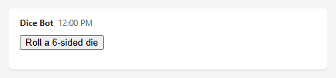
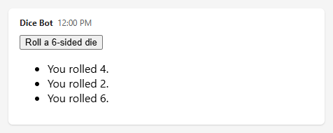

# Build HTML Widgets in Teams Bots

An HTML widget is an HTML document that Teams renders in a sandboxed iframe inside a chat message. Use widgets to bring a custom interactive interface into a conversation, so users can work with your bot without leaving the chat. Your bot sends the HTML in an extended Markdown message, and the widget connects to Teams to resize its interface and call the bot's tools.

This article shows how to create the widget file and send its payload from a TypeScript bot built with the [Teams SDK](https://github.com/microsoft/teams.ts). Then follow [Share the widget with Teams](share-html-widgets.md) to add the handshake, height reporting, and tool calls that make the widget interactive. In that article, share means connecting the embedded widget to its Teams host, not forwarding a message or publishing an app.

## Prerequisites

- A working TypeScript bot built with the Teams SDK.
- A public HTTPS endpoint for your bot.

> [!NOTE]
> HTML widgets are a preview feature. The Teams SDK marks the related APIs as experimental, and they may change.

## The example: a dice roller

Every step in this guide builds the same small widget:

- The bot sends a widget containing a **Roll a 6-sided die** button.
- When the user selects the button, the widget asks the bot to roll the die. The bot picks the number and returns it.
- The widget adds each result to a list. The widget grows with every roll, so the example also shows how widgets resize.

When the bot sends it, the widget looks like this:



After three rolls, the widget has grown to fit its list of results:



## What you write

A widget is an HTML document that Teams renders inside a sandboxed iframe in the chat. You write two pieces of code:

| Piece      | What it is                                                         | Responsibilities                                                              |
| ---------- | ------------------------------------------------------------------ | ----------------------------------------------------------------------------- |
| **Widget** | One HTML file with inline CSS and plain JavaScript. No frameworks. | Performs the handshake with Teams, reports its height, and calls tools.       |
| **Bot**    | TypeScript code in your existing Teams SDK bot.                    | Sends the widget in an extended markdown message, and answers its tool calls. |

## Project layout

```text
widgets/
  dice-widget.html     # The widget: HTML, CSS, and JavaScript in one file
src/
  bot/
    widget-markdown.ts # Puts a widget in a fenced code block, for extended markdown messages
    dice-widget.ts     # Builds the dice widget's payload from dice-widget.html
    dice-tool.ts       # Handles tool calls from the widget
    correlation.ts     # Optional: identifies which widget made a tool call
    mcp-widgets.ts     # Optional: shows widgets from MCP servers
```

---

Follow these steps to send the widget:

1. Step 1: [Create the widget file](#create-the-widget-file)
1. Step 2: [Send the widget](#send-the-widget)

## Create the widget file

Create `widgets/dice-widget.html`. This is the complete page that Teams displays. The `<script>` element at the end is empty for now; Steps 3, 4, and 5 fill it in.

```html
<!doctype html>
<html lang="en">
  <head>
    <meta charset="utf-8" />
    <meta name="viewport" content="width=device-width, initial-scale=1" />
    <title>Dice roller</title>
    <style>
      /* No margins outside the root element, so that the root's height is
         the widget's full height (Step 4). */
      html,
      body {
        margin: 0;
      }

      /* "flow-root" keeps the margins of the root's first and last children
         inside the root, where they are measured (Step 4). */
      #widget-root {
        display: flow-root;
        font-family: system-ui, sans-serif;
      }
    </style>
  </head>
  <body>
    <!-- All visible content goes inside this element. The widget measures
         it to report its height (Step 4). -->
    <div id="widget-root"></div>

    <script>
      // The code from Steps 3, 4, and 5 goes here, in that order.
    </script>
  </body>
</html>
```

Everything is in one file: the CSS and JavaScript are inline, and the widget loads nothing from other origins.

## Send the widget

Widgets are sent in **extended markdown messages**: message activities whose `textFormat` is `"extendedmarkdown"`. The widget goes in the message's `text`, as a fenced code block with the language `html-widget`. The content of the code block is the widget's payload, as JSON:

````text
```html-widget
{"type":"widget/mcp-ui","name":"Dice roller","domain":"https://mybot.example.com","html":"<!doctype html>...", ...}
```
````

Teams displays the code block as the widget. The message's `text` can also contain ordinary markdown around the code block (see [Mix markdown and widgets](#mix-markdown-and-widgets)).

The payload has these fields:

| Field            | Required | Description                                                                                                                                                                                                                                                                           |
| ---------------- | -------- | ------------------------------------------------------------------------------------------------------------------------------------------------------------------------------------------------------------------------------------------------------------------------------------- |
| `type`           | Yes      | Always `"widget/mcp-ui"`.                                                                                                                                                                                                                                                             |
| `name`           | Yes      | Display name of the widget.                                                                                                                                                                                                                                                           |
| `description`    | No       | Short description of the widget.                                                                                                                                                                                                                                                      |
| `domain`         | Yes      | An HTTPS origin associated with the widget. Use your bot's origin.                                                                                                                                                                                                                    |
| `html`           | Yes      | The complete HTML document that Teams renders in the iframe.                                                                                                                                                                                                                          |
| `securityPolicy` | No       | Origins the HTML may use. `resourceDomains` covers external scripts, styles, images, and fonts. `connectDomains` covers `fetch`, XHR, and WebSocket calls. Anything not listed is blocked.                                                                                            |
| `mcpUrl`         | No       | Only for widgets produced by an MCP tool, and always set for them: the URL of the MCP server whose tool produced the widget. Teams uses it to run the widget on a dedicated domain scoped to the bot's ID and the MCP URL. See [Widgets from MCP servers](#widgets-from-mcp-servers). |

### Build the widget's payload

Create `src/bot/dice-widget.ts`:

```ts
import { readFileSync } from "node:fs";
import { resolve } from "node:path";
import type { IHtmlWidgetPayload } from "@microsoft/teams.api";

// The widget file from Step 1, read once when the bot starts. Adjust the
// path to where the file is deployed with your bot.
const DICE_WIDGET_HTML = readFileSync(
  resolve("widgets/dice-widget.html"),
  "utf8",
);

// Creates the payload of the dice widget.
//   botOrigin: your bot's public HTTPS origin, for example
//              https://mybot.example.com. Used as the widget's domain.
export function createDiceWidget(botOrigin: string): IHtmlWidgetPayload {
  return {
    // Always "widget/mcp-ui".
    type: "widget/mcp-ui",
    // Display name of the widget.
    name: "Dice roller",
    description: "Rolls dice on the bot.",
    // Origin associated with the widget. Use the bot's origin.
    domain: botOrigin,
    // The complete widget: HTML, CSS, and JavaScript.
    html: DICE_WIDGET_HTML,
    // Origins that the widget may use. Everything else is blocked. The dice
    // widget is self-contained, so every list is empty.
    securityPolicy: {
      // Targets of fetch, XHR, and WebSocket calls.
      connectDomains: [],
      // Sources of external scripts, styles, images, and fonts.
      resourceDomains: [],
      // Sources of nested iframes.
      frameDomains: [],
      // Allowed <base> URLs.
      baseUriDomains: [],
    },
  };
}
```

### Put the widget in a fenced code block

Create `src/bot/widget-markdown.ts`. It works for any widget:

````ts
import type { IHtmlWidgetPayload } from "@microsoft/teams.api";

// Returns the "html-widget" fenced code block that displays a widget in an
// extended markdown message.
export function widgetMarkdown(widget: IHtmlWidgetPayload): string {
  return "```html-widget\n" + JSON.stringify(widget) + "\n```";
}
````

### Send the message

Send an extended markdown message whose `text` is the widget's fenced code block:

```ts
import { createDiceWidget } from "./dice-widget";
import { widgetMarkdown } from "./widget-markdown";

// `send` comes from the context of the activity you are handling.
await send({
  type: "message",
  // Teams displays "html-widget" code blocks as widgets only in extended
  // markdown messages.
  textFormat: "extendedmarkdown",
  text: widgetMarkdown(createDiceWidget("https://mybot.example.com")),
});
```

> [!IMPORTANT]
> Don't use the `buildHtmlWidgetMessage` or `buildHtmlWidgetMarkdown` helpers exported by `@microsoft/teams.apps`. They add their own handshake and height-reporting code to the widget's HTML, which conflicts with the widget's own code (Steps 3 and 4).

### Mix markdown and widgets

An extended markdown message can contain ordinary markdown around a widget. Build the message's `text` from an array of markdown strings and widgets, joined with blank lines:

```ts
import { createDiceWidget } from "./dice-widget";
import { widgetMarkdown } from "./widget-markdown";

await send({
  type: "message",
  textFormat: "extendedmarkdown",
  // Separate markdown and widgets with blank lines.
  text: [
    "**Feeling lucky?** Roll the die below.",
    widgetMarkdown(createDiceWidget("https://mybot.example.com")),
    "_The bot picks every number._",
  ].join("\n\n"),
});
```

The message's `text` is:

````text
**Feeling lucky?** Roll the die below.

```html-widget
{"type":"widget/mcp-ui","name":"Dice roller", ...}
```

_The bot picks every number._
````

To show several widgets in one message, add a `widgetMarkdown(...)` entry to the array for each of them.

Each message contains the complete widget. Messages that were already sent keep the HTML they were sent with. Changes to `dice-widget.html` apply only to messages you send afterward.

> [!WARNING]
> Anyone who can see the message can read the widget's HTML. Never put secrets, tokens, or private data in it.

If your widget loads anything from another origin, list that origin in the security policy. Use `validateSecurityPolicy`, exported by the Teams SDK's `@microsoft/teams.apps` package, in your unit tests to catch origins that the HTML uses but the policy does not list:

```ts
import { validateSecurityPolicy } from "@microsoft/teams.apps";
import { createDiceWidget } from "./dice-widget";

const widget = createDiceWidget("https://mybot.example.com");

// Returns one warning for each origin that the HTML references but the
// security policy does not allow.
const warnings = validateSecurityPolicy(
  widget.html,
  widget.securityPolicy ?? {},
);
// Expect: warnings is an empty array.
```

### Where widgets run

Teams hosts every widget on a dedicated domain, in this format:

```text
https://<hash>.widget-renderer.usercontent.microsoft
```

`<hash>` depends on where the widget comes from:

| Widget                                          | What to set in the payload                                                 | Domain scoped to              | Text to hash         |
| ----------------------------------------------- | -------------------------------------------------------------------------- | ----------------------------- | -------------------- |
| Your bot's own widgets, such as the dice roller | Nothing                                                                    | Your bot's ID                 | `<bot id>`           |
| A widget produced by an MCP tool                | `mcpUrl`: the URL of the MCP server ([details](#widgets-from-mcp-servers)) | Your bot's ID and the MCP URL | `<bot id>-<mcp URL>` |

When you send a widget produced by an MCP tool, pass the MCP server's URL in the `mcpUrl` field of the widget's payload. Teams then generates the hash from your bot's ID and that URL, so the widget gets its own domain.

To let a widget call one of your services (for example, an API listed in the widget's `connectDomains`), configure that service to accept calls from the widget's domain, for example in its CORS settings.

To find the domain, generate the hash with the [widget domain tool](https://widgettool.z19.web.core.windows.net/). In its box, enter either your bot's ID, or a string in the format `<bot id>-<mcp URL>`.

> [!WARNING]
> If you omit `mcpUrl` from a widget produced by an MCP tool, the widget runs on the domain scoped to your bot's ID only. It can then call any service that accepts calls from that domain, including the services meant for your bot's own widgets. Always pass `mcpUrl` in the payload of widgets produced by MCP tools.

## Step 3: Connect the widget to Teams

Before Teams accepts anything else from the widget, the widget must complete a handshake:

1. Send the `ui/initialize` request.
2. Wait for its response.
3. Send the `ui/notifications/initialized` notification.

Add the following code to the `<script>` element in `dice-widget.html`. It defines a helper that sends requests and waits for their responses, and the `connect` function that performs the handshake.

```js
// How long to wait for a response before giving up, in milliseconds.
const REQUEST_TIMEOUT_MS = 15000;
// Used to give every request a unique id.
let requestCount = 0;
// A promise that completes when the handshake is done. Set by connect().
let connection;

/**
 * Sends a message to Teams.
 * @param {object} message The message, without the "jsonrpc" field.
 * @returns {void}
 */
function postToHost(message) {
  window.parent.postMessage({ jsonrpc: "2.0", ...message }, "*");
}

/**
 * Normalizes an incoming message. Responses can arrive either as objects or
 * as JSON strings.
 * @param {unknown} data The data of a "message" event.
 * @returns {object | undefined} The message, or undefined if it is not an object.
 */
function readMessage(data) {
  if (typeof data === "string") {
    try {
      return JSON.parse(data);
    } catch {
      return undefined;
    }
  }

  return typeof data === "object" && data !== null ? data : undefined;
}

/**
 * Sends a request to Teams and waits for its response.
 * @param {string} method The request's method name.
 * @param {object} params The request's parameters.
 * @returns {Promise<object>} The response's result. Rejects if the response
 *   is an error, or if no response arrives within REQUEST_TIMEOUT_MS.
 */
function sendRequest(method, params) {
  requestCount += 1;
  const id = "request-" + requestCount;

  return new Promise((resolve, reject) => {
    const timer = setTimeout(
      () => finish(new Error(method + " timed out.")),
      REQUEST_TIMEOUT_MS,
    );

    // Settles the promise exactly once and stops listening for responses.
    function finish(error, result) {
      clearTimeout(timer);
      window.removeEventListener("message", onMessage);

      if (error) {
        reject(error);
      } else {
        resolve(result ?? {});
      }
    }

    function onMessage(event) {
      // Only trust messages that come from Teams.
      if (event.source !== window.parent) {
        return;
      }

      const message = readMessage(event.data);

      // Ignore anything that is not the response to this request.
      if (message?.jsonrpc !== "2.0" || message.id !== id) {
        return;
      }

      if (message.error) {
        finish(
          new Error(method + " failed (code " + message.error.code + ")."),
        );
      } else {
        finish(undefined, message.result);
      }
    }

    // Start listening before sending, so the response cannot be missed.
    window.addEventListener("message", onMessage);
    postToHost({ id, method, params });
  });
}

/**
 * Performs the handshake with Teams. Call it once when the widget starts.
 * Calling it again returns the same promise. If the handshake failed, the
 * next call starts a new attempt.
 * @param {string} appName The widget's name, sent to Teams.
 * @returns {Promise<void>} Completes when the handshake is done.
 */
function connect(appName) {
  connection ??= sendRequest("ui/initialize", {
    // The protocol version that this code implements.
    protocolVersion: "2026-01-26",
    appInfo: { name: appName, version: "1.0.0" },
    // This widget declares no optional capabilities.
    appCapabilities: {},
  }).then(
    () => {
      // Tells Teams the widget is ready. Completes the handshake.
      postToHost({ method: "ui/notifications/initialized", params: {} });
    },
    (error) => {
      // Allow a later call to retry.
      connection = undefined;
      throw error;
    },
  );

  return connection;
}
```

## Step 4: Report the widget's height

**A widget's height must be driven by its content.**

Teams sizes the widget's iframe to the height that the widget reports with the `ui/notifications/size-changed` notification. The widget must report its height after the handshake, and again every time it changes.

Add `reportHeight` to the `<script>` element:

```js
/**
 * Reports the height of `root` to Teams now, and every time it changes.
 * @param {HTMLElement} root The element that contains all of the widget's content.
 * @returns {() => void} A function that stops reporting.
 */
function reportHeight(root) {
  let lastHeight;

  function report() {
    // The exact rendered height of the root, in CSS pixels. Can be fractional.
    const height = root.getBoundingClientRect().height;

    // Skip duplicates, unless the iframe is still too short to show everything.
    if (height === lastHeight && window.innerHeight >= height) {
      return;
    }

    lastHeight = height;
    // Teams resizes the iframe to this height. Send it unrounded.
    postToHost({
      method: "ui/notifications/size-changed",
      params: { height },
    });
  }

  // Calls report() whenever the root's size changes for any reason: new
  // content, loaded fonts or images, or text that wraps differently.
  const observer = new ResizeObserver(report);

  observer.observe(root);
  // Report the initial height right away.
  report();

  return () => observer.disconnect();
}
```

Because the iframe is sized from the widget, the widget can't be sized from the iframe. To keep the widget's height driven by its content:

- **Put all content inside one root element, and measure that element** with `getBoundingClientRect().height`. Don't measure `document.documentElement.scrollHeight` or `document.body.scrollHeight`: they are never smaller than the iframe, so the widget could grow but never shrink.
- **Report the exact height.** Don't round it. Rounding up leaves a strip below the widget, and rounding down clips it.
- **Don't size the widget to fit the iframe.** Don't use `100vh`, or `height: 100%` on `html`, `body`, or the root element.
- **Keep all content inside the root, in the normal page flow.** Content placed outside the root with negative margins or `position: fixed` is not measured, so it can be clipped.
- **Remove the margins around the root.** The styles in Step 1 set `html, body { margin: 0; }`, and give the root `display: flow-root` so that the margins of its first and last children are measured.

The dice widget's height is driven by its content: its button, its list of rolls, and its error message.

## Step 5: Call a tool from the widget

A widget asks its bot to do something by calling a tool with a `name` and an `arguments` object. The bot that sent the message containing the widget handles the call in [Step 6](#step-6-handle-tool-calls-in-the-bot).

### The callTool function

Add `callTool` to the `<script>` element:

```js
/**
 * Calls a tool on the bot and returns the bot's result.
 * @param {string} name The tool name that the bot's handler recognizes.
 * @param {object} args The tool's arguments. The bot receives them as
 *   activity.value.arguments.
 * @returns {Promise<{content?: Array<{type: string, text?: string}>,
 *   structuredContent?: object, isError?: boolean}>} The bot's result.
 *   Rejects if the call could not be completed. Resolves with isError: true
 *   if the bot ran the tool and reported a failure.
 */
async function callTool(name, args) {
  // Tool calls are only allowed after the handshake.
  if (!connection) {
    throw new Error("Call connect() before calling tools.");
  }

  await connection;

  return sendRequest("tools/call", { name, arguments: args });
}
```

The result is the `callToolResult` object that your bot returns in [Step 6](#step-6-handle-tool-calls-in-the-bot):

| Field               | Description                                                                        |
| ------------------- | ---------------------------------------------------------------------------------- |
| `content`           | Array of content items. Use `{ type: "text", text }` for a human-readable message. |
| `structuredContent` | An object with data for the widget to render.                                      |
| `isError`           | `true` when the tool failed. The text in `content` explains why.                   |

Handle **both** kinds of failure:

- **The promise rejects** when the call could not be completed: it timed out, or the bot's handler failed.
- **The promise resolves with `isError: true`** when your bot ran the tool and reported a failure.

### The dice widget

Finally, add the widget's own code at the end of the `<script>` element. It builds the UI, connects to Teams, reports its height, and calls `roll_dice` when the button is selected:

```js
// Number of sides on the die.
const SIDES = 6;
const root = document.getElementById("widget-root");

// Build the UI: a button, a list of results, and a place for errors.
const button = document.createElement("button");
const rolls = document.createElement("ul");
const errorMessage = document.createElement("p");

button.type = "button";
button.textContent = "Roll a " + SIDES + "-sided die";
// Screen readers announce errors as soon as they appear.
errorMessage.setAttribute("role", "alert");
root.append(button, rolls, errorMessage);

button.addEventListener("click", async () => {
  // Prevent a second roll while this one is in progress.
  button.disabled = true;
  errorMessage.textContent = "";

  try {
    // Ask the bot to roll. The bot handles "roll_dice" in Step 6.
    const result = await callTool("roll_dice", { sides: SIDES });
    // The bot's human-readable message, if any.
    const text = result.content?.find((item) => item.type === "text")?.text;

    // The bot ran the tool but reported a failure.
    if (result.isError) {
      throw new Error(text ?? "The dice could not be rolled.");
    }

    // Show the rolled value that the bot returned in structuredContent.
    // textContent (not innerHTML) keeps the value from being parsed as HTML.
    const roll = document.createElement("li");

    roll.textContent = "You rolled " + result.structuredContent?.value + ".";
    rolls.append(roll);
  } catch (error) {
    // The call failed or the bot reported an error.
    errorMessage.textContent =
      error instanceof Error ? error.message : String(error);
  } finally {
    button.disabled = false;
  }
});

// Complete the handshake, then start reporting the widget's height. Every
// later change to the root's content is reported automatically.
connect("Dice roller").then(
  () => reportHeight(root),
  () => {
    errorMessage.textContent = "This widget could not connect to Teams.";
  },
);
```

- The button is disabled while a call is in progress, so a quick double click does not roll twice.
- Each new roll and each error message makes the root taller. The `ResizeObserver` from Step 4 reports the new height.

## Step 6: Handle tool calls in the bot

When the widget calls a tool, your bot receives an `htmlwidget/calltool` invoke activity. In the Teams SDK, handle it with the `widget.callTool` route:

- `activity.value.name` is the tool name.
- `activity.value.arguments` is the arguments object, typed as `unknown`.

The handler returns an `IHtmlWidgetCallToolResponse`:

```ts
{
  // Always "htmlwidget/calltoolresult".
  responseType: "htmlwidget/calltoolresult",
  // Returned to the widget as the result of callTool().
  callToolResult: { content, structuredContent, isError },
}
```

Create `src/bot/dice-tool.ts`:

```ts
import { randomInt } from "node:crypto";
import type {
  IHtmlWidgetCallToolInvokeActivity,
  IHtmlWidgetCallToolResponse,
} from "@microsoft/teams.api";

// Builds a tool call response. Always sets all three result fields, because
// fields you omit can reach the widget as null.
//   text:              human-readable message, shown by the widget on errors.
//   structuredContent: data for the widget to render.
//   isError:           true when the tool failed.
function toolResult(
  text: string,
  structuredContent: Record<string, unknown> = {},
  isError = false,
): IHtmlWidgetCallToolResponse {
  return {
    responseType: "htmlwidget/calltoolresult",
    callToolResult: {
      content: [{ type: "text", text }],
      structuredContent,
      isError,
    },
  };
}

// The "roll_dice" tool. Expects arguments of the form { sides: number }.
function rollDice(args: unknown): IHtmlWidgetCallToolResponse {
  // `args` comes from the browser: check its shape before using it. Other
  // properties (such as Teams' reserved __msteams__) are ignored.
  const sides =
    typeof args === "object" && args !== null && "sides" in args
      ? args.sides
      : undefined;

  // Reject invalid input with an error result instead of throwing.
  if (
    typeof sides !== "number" ||
    !Number.isInteger(sides) ||
    sides < 2 ||
    sides > 100
  ) {
    return toolResult("sides must be a whole number from 2 to 100.", {}, true);
  }

  // A random whole number from 1 to `sides`, inclusive.
  const value = randomInt(1, sides + 1);

  // The widget reads `value` from structuredContent.
  return toolResult("You rolled " + value + ".", { value, sides });
}

// Entry point for every tool call from the widget. Dispatches by tool name.
export function handleWidgetTool(
  activity: IHtmlWidgetCallToolInvokeActivity,
): IHtmlWidgetCallToolResponse {
  // The name and arguments that the widget passed to callTool().
  const { name, arguments: args } = activity.value;

  switch (name) {
    case "roll_dice":
      return rollDice(args);
    default:
      // Unknown tools also get an error result, never an exception.
      return toolResult("Unknown tool: " + name, {}, true);
  }
}
```

Register the route on your bot's `App`:

```ts
import type { IHtmlWidgetCallToolResponse } from "@microsoft/teams.api";
import { handleWidgetTool } from "./dice-tool";

// Receives every tool call from widgets that this bot sent.
// `app` is your bot's App.
app.on(
  "widget.callTool",
  async ({ activity }): Promise<IHtmlWidgetCallToolResponse> => {
    try {
      // The return value is sent back to the widget.
      return handleWidgetTool(activity);
    } catch (error) {
      // Safety net for unexpected failures: log the details on the bot, and
      // return an error result rather than letting the invoke fail.
      console.error("Widget tool failed.", error);

      return {
        responseType: "htmlwidget/calltoolresult",
        callToolResult: {
          content: [{ type: "text", text: "Something went wrong." }],
          structuredContent: {},
          isError: true,
        },
      };
    }
  },
);
```

Follow these rules in every tool handler:

1. **Always return a result. Never let the handler throw.** Report failures with `isError: true` and a readable message in `content`. If the handler throws, the invoke fails and the widget receives only a generic error.
2. **Always set all three fields:** `content`, `structuredContent` (use `{}` when there is no data), and `isError`. Fields you omit can reach the widget as `null`, which widgets built with MCP Apps SDKs reject.
3. **Validate `arguments`.** They come from the browser. Treat them as untrusted input, like the body of any HTTP request.
4. **Ignore properties you do not recognize.** Teams can add a reserved `__msteams__` property to `arguments`, so do not reject unexpected properties.
5. **Do not authorize based on `activity.from`.** The invoke identifies the conversation, but it does not reliably carry the user's Microsoft Entra identity. If a tool needs a verified user, the widget must send a token that the bot validates, which is outside the scope of this guide.
6. **Respond quickly.** The user is waiting for the result in the widget.

### Optional: identify which widget is calling

> [!NOTE]
> This behavior is not documented by Teams yet. Treat it as preview behavior.

If you add a top-level `correlationId` string to the widget payload, Teams passes it back with every tool call from that widget in `arguments.__msteams__.correlationId`. Use it to find server-side state that belongs to that specific widget. For example, generate a random UUID, store it with your data, and look it up when a tool is called.

Create `src/bot/correlation.ts`:

```ts
import type {
  IHtmlWidgetCallToolInvokeActivity,
  IHtmlWidgetPayload,
} from "@microsoft/teams.api";

// Use this type for payloads that include a correlationId. The field is not
// part of the published IHtmlWidgetPayload type yet.
type HtmlWidgetPayloadWithCorrelation = IHtmlWidgetPayload & {
  correlationId: string;
};

// Returns the correlationId of the widget that made this tool call, or
// undefined if the widget's payload had none.
export function correlationIdOf(
  activity: IHtmlWidgetCallToolInvokeActivity,
): string | undefined {
  const args = activity.value.arguments;

  // Teams adds the ID under the reserved __msteams__ property of the arguments.
  if (typeof args !== "object" || args === null || !("__msteams__" in args)) {
    return undefined;
  }

  const metadata = args.__msteams__;

  // Accept the value only if it is a string.
  return typeof metadata === "object" &&
    metadata !== null &&
    "correlationId" in metadata &&
    typeof metadata.correlationId === "string"
    ? metadata.correlationId
    : undefined;
}
```

A correlation ID identifies a widget. It does not prove who the user is. Check that the ID exists in your store and belongs to the conversation in `activity.conversation.id` before you use it.

## Widgets from MCP servers

Some MCP servers return a widget along with a tool's result: these tools are MCP App tools. Your bot can show those widgets in Teams the same way as its own widgets. It sends each widget in an extended markdown message, and forwards the widget's tool calls to the MCP server that provided it.

This section assumes that your bot already calls tools on MCP servers with a `Client` from the MCP TypeScript SDK (`@modelcontextprotocol/sdk`). It uses the correlation ID from [Optional: identify which widget is calling](#optional-identify-which-widget-is-calling) to route each widget's tool calls to the right MCP server.

### Declare widget support

MCP servers only return widgets to clients that support them. Declare that support when you create the MCP client:

```ts
import { Client } from "@modelcontextprotocol/sdk/client/index.js";

const client = new Client(
  { name: "My bot", version: "1.0.0" },
  {
    capabilities: {
      // Tells MCP servers that this client can display MCP App widgets.
      extensions: {
        "io.modelcontextprotocol/ui": {
          mimeTypes: ["text/html;profile=mcp-app"],
        },
      },
    },
  },
);
```

### Call the tool and create the widget

An MCP App tool declares its widget with a `ui://` URI in the tool's `_meta.ui.resourceUri` field. The widget's HTML is a resource on the MCP server, which the bot reads with `readResource`. The server can also declare the widget's domain, security policy, and permissions.

A widget produced by an MCP tool must include the `mcpUrl` field in its payload: the URL of the MCP server whose tool produced it.

> [!IMPORTANT]
> Always set `mcpUrl` on widgets produced by MCP tools. Teams uses it to run the widget on a dedicated domain, scoped to your bot's ID and to that MCP server's URL. This keeps widgets from different MCP servers isolated from each other and from your bot's own widgets. Without `mcpUrl`, an MCP widget runs on the domain scoped to your bot's ID only, and can call any service that accepts calls from that domain. See [Where widgets run](#where-widgets-run).

Create `src/bot/mcp-widgets.ts`. Its imports cover the code in this section and in [Forward the widget's tool calls](#forward-the-widgets-tool-calls):

```ts
import { randomUUID } from "node:crypto";
import type { Client } from "@modelcontextprotocol/sdk/client/index.js";
import {
  CallToolResultSchema,
  type CallToolResult,
  type Tool,
} from "@modelcontextprotocol/sdk/types.js";
import type {
  IHtmlWidgetCallToolInvokeActivity,
  IHtmlWidgetCallToolResponse,
  IHtmlWidgetPayload,
  IHtmlWidgetPermissions,
  IHtmlWidgetSecurityPolicy,
} from "@microsoft/teams.api";
import { correlationIdOf } from "./correlation";

// The MIME type of MCP App widgets.
const MCP_APP_MIME_TYPE = "text/html;profile=mcp-app";

// A widget payload from an MCP tool. The correlationId and mcpUrl fields are
// not part of the published IHtmlWidgetPayload type yet.
export type McpWidgetPayload = IHtmlWidgetPayload & {
  correlationId: string;
  mcpUrl: string;
};

// Settings that an MCP server can declare for a widget, in the _meta.ui field
// of the widget's resource.
interface McpWidgetSettings {
  domain?: string;
  csp?: IHtmlWidgetSecurityPolicy;
  permissions?: IHtmlWidgetPermissions;
}

// Where tool calls from an MCP widget go.
interface McpWidgetRoute {
  // The client connected to the MCP server that provided the widget.
  client: Client;
  // The conversation that the widget was sent to.
  conversationId: string;
}

// The routes of the MCP widgets that this bot sent, by correlationId. In
// production, keep them in persistent storage: widgets in older messages can
// still call tools after your bot restarts.
const routes = new Map<string, McpWidgetRoute>();

// Returns the _meta.ui object of an MCP tool or resource, or undefined.
function uiMetadata(
  meta: Record<string, unknown> | undefined,
): object | undefined {
  const ui = meta?.ui;

  return typeof ui === "object" && ui !== null ? ui : undefined;
}

// Returns the ui:// URI of a tool's widget, or undefined if the tool has none.
function widgetUri(tool: Tool): string | undefined {
  const ui = uiMetadata(tool._meta);

  return ui && "resourceUri" in ui && typeof ui.resourceUri === "string"
    ? ui.resourceUri
    : undefined;
}

// Calls an MCP tool and, if the tool has a widget, creates the widget's
// payload.
//   client:         client connected to the MCP server that provides the tool.
//   serverUrl:      URL of that MCP server, the one the client connected to.
//                   Sent as the widget's mcpUrl. Its origin is the widget's
//                   domain if the server doesn't declare one.
//   conversationId: the conversation the widget will be sent to.
//   tool:           the tool, as returned by client.listTools().
//   args:           the tool's arguments.
// Returns the tool's result, and the widget's payload if the tool has a widget.
export async function callMcpTool(
  client: Client,
  serverUrl: string,
  conversationId: string,
  tool: Tool,
  args: Record<string, unknown>,
): Promise<{ result: CallToolResult; widget?: McpWidgetPayload }> {
  const result = CallToolResultSchema.parse(
    await client.callTool({ name: tool.name, arguments: args }),
  );
  const uri = widgetUri(tool);

  // No widget for tools without one, or when the tool failed.
  if (!uri || result.isError) {
    return { result };
  }

  // Read the widget's HTML and settings from the MCP server.
  const resource = await client.readResource({ uri });
  const content = resource.contents.find((item) => item.uri === uri);

  if (!content || content.mimeType !== MCP_APP_MIME_TYPE) {
    throw new Error("The MCP server did not return the tool's widget.");
  }

  // The HTML is either text, or base64-encoded binary data.
  const html =
    "text" in content
      ? content.text
      : Buffer.from(content.blob, "base64").toString("utf8");
  const settings: McpWidgetSettings = uiMetadata(content._meta) ?? {};

  // Remember where this widget's tool calls must go.
  const correlationId = randomUUID();

  routes.set(correlationId, { client, conversationId });

  return {
    result,
    widget: {
      type: "widget/mcp-ui",
      name: tool.title ?? tool.name,
      description: tool.description,
      domain: settings.domain ?? new URL(serverUrl).origin,
      html,
      securityPolicy: settings.csp,
      permissions: settings.permissions,
      // The tool's arguments and result. Teams passes them to the widget,
      // which typically renders the result.
      toolInput: args,
      toolOutput: result,
      // Teams passes this back with every tool call from the widget.
      correlationId,
      // The URL of the MCP server whose tool produced the widget. Teams runs
      // the widget on a dedicated domain scoped to the bot's ID and this URL.
      mcpUrl: serverUrl,
    },
  };
}
```

### Send the widget

Call the MCP tool with `callMcpTool` instead of `client.callTool`. If the tool returned a widget, send it:

```ts
import { callMcpTool } from "./mcp-widgets";
import { widgetMarkdown } from "./widget-markdown";

// `client` is your MCP client, `tool` comes from client.listTools(), and
// `args` are the tool's arguments, for example chosen by your model.
const { result, widget } = await callMcpTool(
  client,
  "https://mcp.example.com/mcp",
  activity.conversation.id,
  tool,
  args,
);

if (widget) {
  await send({
    type: "message",
    textFormat: "extendedmarkdown",
    text: widgetMarkdown(widget),
  });
}

// Use `result` as you would for any MCP tool, for example by passing it back
// to your model.
```

An MCP widget's HTML already performs the handshake and reports its height. Send it unchanged. To add markdown around an MCP widget, put `widgetMarkdown(widget)` in a `text` array, as shown in [Mix markdown and widgets](#mix-markdown-and-widgets).

### Forward the widget's tool calls

When an MCP widget calls a tool, the bot forwards the call to the MCP server that provided the widget, and returns the server's result to the widget.

Add the following code to `src/bot/mcp-widgets.ts`:

```ts
// Returns true if widgets may call this tool. MCP servers can restrict a tool
// to the model by setting its _meta.ui.visibility field to ["model"].
function isAvailableToWidgets(tool: Tool): boolean {
  const ui = uiMetadata(tool._meta);
  const visibility =
    ui && "visibility" in ui && Array.isArray(ui.visibility)
      ? ui.visibility
      : ["model", "app"];

  return visibility.includes("app");
}

// Builds a tool call response that reports an error to the widget.
function errorResult(text: string): IHtmlWidgetCallToolResponse {
  return {
    responseType: "htmlwidget/calltoolresult",
    callToolResult: {
      content: [{ type: "text", text }],
      structuredContent: {},
      isError: true,
    },
  };
}

// Forwards a tool call from an MCP widget to the MCP server that provided the
// widget, and returns the server's result to the widget.
// Returns undefined if the call does not come from an MCP widget.
export async function handleMcpWidgetTool(
  activity: IHtmlWidgetCallToolInvokeActivity,
): Promise<IHtmlWidgetCallToolResponse | undefined> {
  const correlationId = correlationIdOf(activity);

  // Only MCP widgets have a correlationId in this bot.
  if (!correlationId) {
    return undefined;
  }

  const route = routes.get(correlationId);

  // The widget must have been sent by this bot, to this conversation.
  if (!route || route.conversationId !== activity.conversation.id) {
    return errorResult("This widget is no longer available.");
  }

  // The tool must exist, and widgets must be allowed to call it. (If the
  // server has many tools, follow nextCursor to list all of them.)
  const { tools } = await route.client.listTools();
  const tool = tools.find((entry) => entry.name === activity.value.name);

  if (!tool || !isAvailableToWidgets(tool)) {
    return errorResult("Unknown tool: " + activity.value.name);
  }

  // Remove Teams' reserved __msteams__ property before forwarding the
  // arguments to the MCP server.
  const { __msteams__, ...args } = activity.value.arguments as Record<
    string,
    unknown
  >;
  const result = CallToolResultSchema.parse(
    await route.client.callTool({ name: tool.name, arguments: args }),
  );

  return {
    responseType: "htmlwidget/calltoolresult",
    callToolResult: {
      // Teams does not support resource_link items, so they are removed.
      content: result.content.filter((item) => item.type !== "resource_link"),
      // Always set these fields: fields you omit can reach the widget as null.
      structuredContent: result.structuredContent ?? {},
      isError: result.isError ?? false,
    },
  };
}
```

Then update the `widget.callTool` route from [Step 6](#step-6-handle-tool-calls-in-the-bot), so that it sends tool calls from MCP widgets to `handleMcpWidgetTool`:

```ts
import type { IHtmlWidgetCallToolResponse } from "@microsoft/teams.api";
import { handleWidgetTool } from "./dice-tool";
import { handleMcpWidgetTool } from "./mcp-widgets";

app.on(
  "widget.callTool",
  async ({ activity }): Promise<IHtmlWidgetCallToolResponse> => {
    try {
      // Tool calls from MCP widgets go to their MCP server. All other tool
      // calls are handled by the bot itself.
      return (
        (await handleMcpWidgetTool(activity)) ?? handleWidgetTool(activity)
      );
    } catch (error) {
      // Safety net for unexpected failures, including MCP server errors.
      console.error("Widget tool failed.", error);

      return {
        responseType: "htmlwidget/calltoolresult",
        callToolResult: {
          content: [{ type: "text", text: "Something went wrong." }],
          structuredContent: {},
          isError: true,
        },
      };
    }
  },
);
```

`handleMcpWidgetTool` follows the same rules as any tool handler in Step 6, and adds these:

- **Only forward calls from widgets you sent.** A call is forwarded only if its correlation ID is known and belongs to the same conversation.
- **Only forward tools that widgets may call.** A tool whose `_meta.ui.visibility` is `["model"]` is reserved for the model.
- **Remove `__msteams__` from the arguments.** It is meant for your bot, not for the MCP server.
- **Return the server's result.** Set `structuredContent` and `isError` even if the server omitted them, and remove `resource_link` content items, which Teams does not support.

## Put it all together

Your existing bot needs two additions:

1. A `send` call for the extended markdown message that contains the widget ([Step 2](#send-the-message)).
2. The `widget.callTool` route ([Step 6](#step-6-handle-tool-calls-in-the-bot)).

The `<script>` element in `widgets/dice-widget.html` contains the code from [Step 3](#step-3-connect-the-widget-to-teams), [Step 4](#step-4-report-the-widgets-height), and [Step 5](#step-5-call-a-tool-from-the-widget), in that order.

To show widgets from MCP servers, also declare widget support on your MCP client, call MCP tools with `callMcpTool`, and send tool calls from MCP widgets to `handleMcpWidgetTool` ([Widgets from MCP servers](#widgets-from-mcp-servers)).

To try it:

1. Run your bot and make it send the widget in a Teams chat.
2. Select **Roll a 6-sided die** a few times. Each roll appears in the list, and the widget grows to fit it without a scroll bar.

## Checklist

**Sending the widget**

- [ ] The widget is one HTML file with inline CSS and JavaScript.
- [ ] The widget is sent in an extended markdown message (`textFormat: "extendedmarkdown"`), as an `html-widget` fenced code block containing the payload. The message is not built with `buildHtmlWidgetMessage` or `buildHtmlWidgetMarkdown`.
- [ ] Any origin the HTML loads from is in `resourceDomains`; any origin it calls is in `connectDomains`.
- [ ] The HTML contains no secrets.
- [ ] Services that the widget calls accept calls from the widget's domain, `https://<hash>.widget-renderer.usercontent.microsoft`.

**Handshake and size**

- [ ] The handshake (`ui/initialize`, then `ui/notifications/initialized`) completes before anything else.
- [ ] The widget's height is driven by its content: the widget measures one root element with `getBoundingClientRect().height`, never `scrollHeight`, and is not sized to fit the iframe (`100vh`, or `height: 100%` on `html`, `body`, or the root).
- [ ] Heights are reported exactly, without rounding, from a `ResizeObserver`.
- [ ] `html` and `body` have no margin, the root uses `display: flow-root`, and all content stays inside the root, in the normal page flow.

**Tool calls**

- [ ] The widget calls tools in response to user actions.
- [ ] The widget handles both a rejected `callTool` promise and a result with `isError: true`.
- [ ] The bot's handler always returns `content`, `structuredContent`, and `isError`, and never throws.
- [ ] The bot validates `arguments`, ignores unknown properties such as `__msteams__`, and does not authorize based on `activity.from`.

**Widgets from MCP servers**

- [ ] The MCP client declares the `io.modelcontextprotocol/ui` extension.
- [ ] Each MCP widget's payload includes `mcpUrl`, the URL of the MCP server whose tool produced it, so the widget runs on a dedicated domain scoped to the bot's ID and that URL.
- [ ] Each MCP widget has a unique `correlationId`, stored with its MCP server and conversation.
- [ ] Tool calls are forwarded only for known widgets in the same conversation, and only for tools that widgets may call.
- [ ] `__msteams__` is removed from the arguments before they are forwarded.

## Reference: messages

| Code   | Message                                         | Kind         | Payload                                                            | Reply                                                            |
| ------ | ----------------------------------------------- | ------------ | ------------------------------------------------------------------ | ---------------------------------------------------------------- |
| Widget | `ui/initialize`                                 | Request      | `{ protocolVersion, appInfo: { name, version }, appCapabilities }` | Object that can include `hostContext`, such as the current theme |
| Widget | `ui/notifications/initialized`                  | Notification | `{}`                                                               | None                                                             |
| Widget | `ui/notifications/size-changed`                 | Notification | `{ height }` in CSS pixels                                         | None                                                             |
| Widget | `tools/call`                                    | Request      | `{ name, arguments }`                                              | The bot's `callToolResult`                                       |
| Bot    | `widget.callTool` route (`htmlwidget/calltool`) | Handler      | `activity.value`: `{ name, arguments }`                            | `{ responseType: "htmlwidget/calltoolresult", callToolResult }`  |

Requests wait for a reply. Notifications do not.
