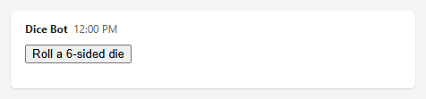
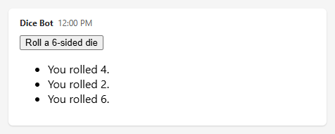

# Send HTML widgets

HTML Widgets are a new type of rich content bots and agents can send in Teams messages. Widgets are built on top of the [MCP Apps standard](https://github.com/modelcontextprotocol/ext-apps/blob/main/specification/2026-01-26/apps.mdx). This guide shows how a Teams bot written in TypeScript with the [Teams SDK](https://github.com/microsoft/teams.ts) can:

1. **Send** an interactive HTML widget into a chat.
2. **Size the widget correctly**, so that Teams always shows all of its content.
3. **Handle `callTool` requests** that the widget sends back to the bot.

## Prerequisites

- A working TypeScript bot built with the Teams SDK.
- A public HTTPS endpoint for your bot.

> [!NOTE]
> HTML widgets are a preview feature. The Teams SDK marks the related APIs as experimental, and they may change.

## The example: a dice roller

Every step in this guide builds the same small widget:

- The bot sends a widget containing a **Roll a 6-sided die** button.
- When the user selects the button, the widget asks the bot to roll the die. The bot picks the number and returns it.
- The widget adds each result to a list. The widget grows with every roll, so the example also shows how widgets resize.

When the bot sends it, the widget looks like this:



After three rolls, the widget has grown to fit its list of results:



## What you write

A widget is an HTML document that Teams renders inside a sandboxed iframe in the chat. You write two pieces of code:

| Piece      | What it is                                                         | Responsibilities                                                              |
| ---------- | ------------------------------------------------------------------ | ----------------------------------------------------------------------------- |
| **Widget** | One HTML file with inline CSS and plain JavaScript. No frameworks. | Performs the handshake with Teams, reports its height, and calls tools.       |
| **Bot**    | TypeScript code in your existing Teams SDK bot.                    | Sends the widget in an extended Markdown message, and answers its tool calls. |

## Project layout

```text
widgets/
  dice-widget.html     # The widget: HTML, CSS, and JavaScript in one file
src/
  bot/
    widget-markdown.ts # Puts a widget in a fenced code block, for extended markdown messages
    dice-widget.ts     # Builds the dice widget's payload from dice-widget.html
    dice-tool.ts       # Handles tool calls from the widget
    correlation.ts     # Optional: identifies which widget made a tool call
    mcp-widgets.ts     # Optional: shows widgets from MCP servers
```

---

## Step 1: Create the widget file

Create `widgets/dice-widget.html`. This is the complete page that Teams displays. The `<script>` element at the end is empty for now; Steps 3, 4, and 5 fill it in.

```html
<!doctype html>
<html lang="en">
  <head>
    <meta charset="utf-8" />
    <meta name="viewport" content="width=device-width, initial-scale=1" />
    <title>Dice roller</title>
    <style>
      /* No margins outside the root element, so that the root's height is
         the widget's full height (Step 4). */
      html,
      body {
        margin: 0;
      }

      /* "flow-root" keeps the margins of the root's first and last children
         inside the root, where they are measured (Step 4). */
      #widget-root {
        display: flow-root;
        font-family: system-ui, sans-serif;
      }
    </style>
  </head>
  <body>
    <!-- All visible content goes inside this element. The widget measures
         it to report its height (Step 4). -->
    <div id="widget-root"></div>

    <script>
      // The code from Steps 3, 4, and 5 goes here, in that order.
    </script>
  </body>
</html>
```

Everything is in one file: the CSS and JavaScript are inline, and the widget loads nothing from other origins. For more details on creating a widget, see [UX guidelines for HTML widgets in Microsoft Teams](ux-guidelines.md).

## Step 2: Send the widget

Widgets are sent in **extended markdown messages**: message activities whose `textFormat` is `"extendedmarkdown"`. The widget goes in the message's `text`, as a fenced code block with the language `html-widget`. The content of the code block is the widget's payload, as JSON:

````text
```html-widget
{"type":"widget/mcp-ui","name":"Dice roller","domain":"https://mybot.example.com","html":"<!doctype html>...", ...}
```
````

Teams displays the code block as the widget. The message's `text` can also contain ordinary Markdown around the code block (see [Mix Markdown and widgets](#mix-markdown-and-widgets)).

The payload has these fields:

| Field            | Required | Description                                                                                                                                                                                                                                                                           |
| ---------------- | -------- | ------------------------------------------------------------------------------------------------------------------------------------------------------------------------------------------------------------------------------------------------------------------------------------- |
| `type`           | Yes      | Always `"widget/mcp-ui"`.                                                                                                                                                                                                                                                             |
| `name`           | Yes      | Display name of the widget.                                                                                                                                                                                                                                                           |
| `description`    | No       | Short description of the widget.                                                                                                                                                                                                                                                      |
| `domain`         | Yes      | An HTTPS origin associated with the widget. Use your bot's origin.                                                                                                                                                                                                                    |
| `html`           | Yes      | The complete HTML document that Teams renders in the iframe.                                                                                                                                                                                                                          |
| `securityPolicy` | No       | Origins the HTML may use. `resourceDomains` covers external scripts, styles, images, and fonts. `connectDomains` covers `fetch`, XHR, and WebSocket calls. Anything not listed is blocked.                                                                                            |
| `mcpUrl`         | No       | Only for widgets produced by an MCP tool, and always set for them: the URL of the MCP server whose tool produced the widget. Teams uses it to run the widget on a dedicated domain scoped to the bot's ID and the MCP URL. See [Widgets from MCP servers](serve-html-widgets.md#widgets-from-mcp-servers). |

### Build the widget's payload

Create `src/bot/dice-widget.ts`:

```ts
import { readFileSync } from "node:fs";
import { resolve } from "node:path";
import type { IHtmlWidgetPayload } from "@microsoft/teams.api";

// The widget file from Step 1, read once when the bot starts. Adjust the
// path to where the file is deployed with your bot.
const DICE_WIDGET_HTML = readFileSync(
  resolve("widgets/dice-widget.html"),
  "utf8",
);

// Creates the payload of the dice widget.
//   botOrigin: your bot's public HTTPS origin, for example
//              https://mybot.example.com. Used as the widget's domain.
export function createDiceWidget(botOrigin: string): IHtmlWidgetPayload {
  return {
    // Always "widget/mcp-ui".
    type: "widget/mcp-ui",
    // Display name of the widget.
    name: "Dice roller",
    description: "Rolls dice on the bot.",
    // Origin associated with the widget. Use the bot's origin.
    domain: botOrigin,
    // The complete widget: HTML, CSS, and JavaScript.
    html: DICE_WIDGET_HTML,
    // Origins that the widget may use. Everything else is blocked. The dice
    // widget is self-contained, so every list is empty.
    securityPolicy: {
      // Targets of fetch, XHR, and WebSocket calls.
      connectDomains: [],
      // Sources of external scripts, styles, images, and fonts.
      resourceDomains: [],
      // Sources of nested iframes.
      frameDomains: [],
      // Allowed <base> URLs.
      baseUriDomains: [],
    },
  };
}
```

### Put the widget in a fenced code block

Create `src/bot/widget-markdown.ts`. It works for any widget:

````ts
import type { IHtmlWidgetPayload } from "@microsoft/teams.api";

// Returns the "html-widget" fenced code block that displays a widget in an
// extended markdown message.
export function widgetMarkdown(widget: IHtmlWidgetPayload): string {
  return "```html-widget\n" + JSON.stringify(widget) + "\n```";
}
````

### Send the message

Send an extended markdown message whose `text` is the widget's fenced code block:

```ts
import { createDiceWidget } from "./dice-widget";
import { widgetMarkdown } from "./widget-markdown";

// `send` comes from the context of the activity you are handling.
await send({
  type: "message",
  // Teams displays "html-widget" code blocks as widgets only in extended
  // markdown messages.
  textFormat: "extendedmarkdown",
  text: widgetMarkdown(createDiceWidget("https://mybot.example.com")),
});
```

> [!IMPORTANT]
> Don't use the `buildHtmlWidgetMessage` or `buildHtmlWidgetMarkdown` helpers exported by `@microsoft/teams.apps`. They add their own handshake and height-reporting code to the widget's HTML, which conflicts with the widget's own code (Steps 3 and 4).

### Mix Markdown and widgets

An extended Markdown message can contain ordinary Markdown around a widget. Build the message's `text` from an array of Markdown strings and widgets, joined with blank lines:

```ts
import { createDiceWidget } from "./dice-widget";
import { widgetMarkdown } from "./widget-markdown";

await send({
  type: "message",
  textFormat: "extendedmarkdown",
  // Separate markdown and widgets with blank lines.
  text: [
    "**Feeling lucky?** Roll the die below.",
    widgetMarkdown(createDiceWidget("https://mybot.example.com")),
    "_The bot picks every number._",
  ].join("\n\n"),
});
```

The message's `text` is:

````text
**Feeling lucky?** Roll the die below.

```html-widget
{"type":"widget/mcp-ui","name":"Dice roller", ...}
```

_The bot picks every number._
````

To show several widgets in one message, add a `widgetMarkdown(...)` entry to the array for each of them.

Each message contains the complete widget. Messages that were already sent keep the HTML they were sent with. Changes to `dice-widget.html` apply only to messages you send afterward.

> [!WARNING]
> Anyone who can see the message can read the widget's HTML. Never put secrets, tokens, or private data in it.

If your widget loads anything from another origin, list that origin in the security policy. Use `validateSecurityPolicy`, exported by the Teams SDK's `@microsoft/teams.apps` package, in your unit tests to catch origins that the HTML uses but the policy does not list:

```ts
import { validateSecurityPolicy } from "@microsoft/teams.apps";
import { createDiceWidget } from "./dice-widget";

const widget = createDiceWidget("https://mybot.example.com");

// Returns one warning for each origin that the HTML references but the
// security policy does not allow.
const warnings = validateSecurityPolicy(
  widget.html,
  widget.securityPolicy ?? {},
);
// Expect: warnings is an empty array.
```

### Where widgets run

Teams hosts every widget on a dedicated domain, in this format:

```text
https://<hash>.widget-renderer.usercontent.microsoft
```

`<hash>` depends on where the widget comes from:

| Widget                                          | What to set in the payload                                                 | Domain scoped to              | Text to hash         |
| ----------------------------------------------- | -------------------------------------------------------------------------- | ----------------------------- | -------------------- |
| Your bot's own widgets, such as the dice roller | Nothing                                                                    | Your bot's ID                 | `<bot id>`           |
| A widget produced by an MCP tool                | `mcpUrl`: the URL of the MCP server ([details](serve-html-widgets.md#widgets-from-mcp-servers)) | Your bot's ID and the MCP URL | `<bot id>-<mcp URL>` |

When you send a widget produced by an MCP tool, pass the MCP server's URL in the `mcpUrl` field of the widget's payload. Teams then generates the hash from your bot's ID and that URL, so the widget gets its own domain.

To let a widget call one of your services (for example, an API listed in the widget's `connectDomains`), configure that service to accept calls from the widget's domain, for example in its CORS settings.

To find the domain, generate the hash with the [widget domain tool](https://widgettool.z19.web.core.windows.net/). In its box, enter either your bot's ID, or a string in the format `<bot id>-<mcp URL>`.

> [!WARNING]
> If you omit `mcpUrl` from a widget produced by an MCP tool, the widget runs on the domain scoped to your bot's ID only. It can then call any service that accepts calls from that domain, including the services meant for your bot's own widgets. Always pass `mcpUrl` in the payload of widgets produced by MCP tools.

## Step 3: Connect the widget to Teams

Before Teams accepts anything else from the widget, the widget must complete a handshake:

1. Send the `ui/initialize` request.
2. Wait for its response.
3. Send the `ui/notifications/initialized` notification.

Add the following code to the `<script>` element in `dice-widget.html`. It defines a helper that sends requests and waits for their responses, and the `connect` function that performs the handshake.

```js
// How long to wait for a response before giving up, in milliseconds.
const REQUEST_TIMEOUT_MS = 15000;
// Used to give every request a unique id.
let requestCount = 0;
// A promise that completes when the handshake is done. Set by connect().
let connection;

/**
 * Sends a message to Teams.
 * @param {object} message The message, without the "jsonrpc" field.
 * @returns {void}
 */
function postToHost(message) {
  window.parent.postMessage({ jsonrpc: "2.0", ...message }, "*");
}

/**
 * Normalizes an incoming message. Responses can arrive either as objects or
 * as JSON strings.
 * @param {unknown} data The data of a "message" event.
 * @returns {object | undefined} The message, or undefined if it is not an object.
 */
function readMessage(data) {
  if (typeof data === "string") {
    try {
      return JSON.parse(data);
    } catch {
      return undefined;
    }
  }

  return typeof data === "object" && data !== null ? data : undefined;
}

/**
 * Sends a request to Teams and waits for its response.
 * @param {string} method The request's method name.
 * @param {object} params The request's parameters.
 * @returns {Promise<object>} The response's result. Rejects if the response
 *   is an error, or if no response arrives within REQUEST_TIMEOUT_MS.
 */
function sendRequest(method, params) {
  requestCount += 1;
  const id = "request-" + requestCount;

  return new Promise((resolve, reject) => {
    const timer = setTimeout(
      () => finish(new Error(method + " timed out.")),
      REQUEST_TIMEOUT_MS,
    );

    // Settles the promise exactly once and stops listening for responses.
    function finish(error, result) {
      clearTimeout(timer);
      window.removeEventListener("message", onMessage);

      if (error) {
        reject(error);
      } else {
        resolve(result ?? {});
      }
    }

    function onMessage(event) {
      // Only trust messages that come from Teams.
      if (event.source !== window.parent) {
        return;
      }

      const message = readMessage(event.data);

      // Ignore anything that is not the response to this request.
      if (message?.jsonrpc !== "2.0" || message.id !== id) {
        return;
      }

      if (message.error) {
        finish(
          new Error(method + " failed (code " + message.error.code + ")."),
        );
      } else {
        finish(undefined, message.result);
      }
    }

    // Start listening before sending, so the response cannot be missed.
    window.addEventListener("message", onMessage);
    postToHost({ id, method, params });
  });
}

/**
 * Performs the handshake with Teams. Call it once when the widget starts.
 * Calling it again returns the same promise. If the handshake failed, the
 * next call starts a new attempt.
 * @param {string} appName The widget's name, sent to Teams.
 * @returns {Promise<void>} Completes when the handshake is done.
 */
function connect(appName) {
  connection ??= sendRequest("ui/initialize", {
    // The protocol version that this code implements.
    protocolVersion: "2026-01-26",
    appInfo: { name: appName, version: "1.0.0" },
    // This widget declares no optional capabilities.
    appCapabilities: {},
  }).then(
    () => {
      // Tells Teams the widget is ready. Completes the handshake.
      postToHost({ method: "ui/notifications/initialized", params: {} });
    },
    (error) => {
      // Allow a later call to retry.
      connection = undefined;
      throw error;
    },
  );

  return connection;
}
```

## Step 4: Report the widget's height

**A widget's height must be driven by its content.**

Teams sizes the widget's iframe to the height that the widget reports with the `ui/notifications/size-changed` notification. The widget must report its height after the handshake, and again every time it changes.

Add `reportHeight` to the `<script>` element:

```js
/**
 * Reports the height of `root` to Teams now, and every time it changes.
 * @param {HTMLElement} root The element that contains all of the widget's content.
 * @returns {() => void} A function that stops reporting.
 */
function reportHeight(root) {
  let lastHeight;

  function report() {
    // The exact rendered height of the root, in CSS pixels. Can be fractional.
    const height = root.getBoundingClientRect().height;

    // Skip duplicates, unless the iframe is still too short to show everything.
    if (height === lastHeight && window.innerHeight >= height) {
      return;
    }

    lastHeight = height;
    // Teams resizes the iframe to this height. Send it unrounded.
    postToHost({
      method: "ui/notifications/size-changed",
      params: { height },
    });
  }

  // Calls report() whenever the root's size changes for any reason: new
  // content, loaded fonts or images, or text that wraps differently.
  const observer = new ResizeObserver(report);

  observer.observe(root);
  // Report the initial height right away.
  report();

  return () => observer.disconnect();
}
```

Because the iframe is sized from the widget, the widget can't be sized from the iframe. To keep the widget's height driven by its content:

- **Put all content inside one root element, and measure that element** with `getBoundingClientRect().height`. Don't measure `document.documentElement.scrollHeight` or `document.body.scrollHeight`. These values are never smaller than the iframe, so the widget could grow but never shrink.
- **Report the exact height.** Don't round it. Rounding up leaves a strip below the widget, and rounding down clips it.
- **Don't size the widget to fit the iframe.** Don't use `100vh`, or `height: 100%` on `html`, `body`, or the root element.
- **Keep all content inside the root, in the normal page flow.** Content placed outside the root with negative margins or `position: fixed` is not measured, so it can be clipped.
- **Remove the margins around the root.** The styles in Step 1 set `html, body { margin: 0; }`, and give the root `display: flow-root` so that the margins of its first and last children are measured.

The dice widget's height is driven by its content: its button, its list of rolls, and its error message.

## Step 5: Call a tool from the widget

A widget asks its bot to do something by calling a tool with a `name` and an `arguments` object. The bot that sent the message containing the widget handles the call in [Step 6](#step-6-handle-tool-calls-in-the-bot).

### The callTool function

Add `callTool` to the `<script>` element:

```js
/**
 * Calls a tool on the bot and returns the bot's result.
 * @param {string} name The tool name that the bot's handler recognizes.
 * @param {object} args The tool's arguments. The bot receives them as
 *   activity.value.arguments.
 * @returns {Promise<{content?: Array<{type: string, text?: string}>,
 *   structuredContent?: object, isError?: boolean}>} The bot's result.
 *   Rejects if the call could not be completed. Resolves with isError: true
 *   if the bot ran the tool and reported a failure.
 */
async function callTool(name, args) {
  // Tool calls are only allowed after the handshake.
  if (!connection) {
    throw new Error("Call connect() before calling tools.");
  }

  await connection;

  return sendRequest("tools/call", { name, arguments: args });
}
```

The result is the `callToolResult` object that your bot returns in [Step 6](#step-6-handle-tool-calls-in-the-bot):

| Field               | Description                                                                        |
| ------------------- | ---------------------------------------------------------------------------------- |
| `content`           | Array of content items. Use `{ type: "text", text }` for a human-readable message. |
| `structuredContent` | An object with data for the widget to render.                                      |
| `isError`           | `true` when the tool failed. The text in `content` explains why.                   |

Handle **both** kinds of failure:

- **The promise rejects** when the call could not be completed: it timed out, or the bot's handler failed.
- **The promise resolves with `isError: true`** when your bot ran the tool and reported a failure.

### The dice widget

Finally, add the widget's own code at the end of the `<script>` element. It builds the UI, connects to Teams, reports its height, and calls `roll_dice` when the button is selected:

```js
// Number of sides on the die.
const SIDES = 6;
const root = document.getElementById("widget-root");

// Build the UI: a button, a list of results, and a place for errors.
const button = document.createElement("button");
const rolls = document.createElement("ul");
const errorMessage = document.createElement("p");

button.type = "button";
button.textContent = "Roll a " + SIDES + "-sided die";
// Screen readers announce errors as soon as they appear.
errorMessage.setAttribute("role", "alert");
root.append(button, rolls, errorMessage);

button.addEventListener("click", async () => {
  // Prevent a second roll while this one is in progress.
  button.disabled = true;
  errorMessage.textContent = "";

  try {
    // Ask the bot to roll. The bot handles "roll_dice" in Step 6.
    const result = await callTool("roll_dice", { sides: SIDES });
    // The bot's human-readable message, if any.
    const text = result.content?.find((item) => item.type === "text")?.text;

    // The bot ran the tool but reported a failure.
    if (result.isError) {
      throw new Error(text ?? "The dice could not be rolled.");
    }

    // Show the rolled value that the bot returned in structuredContent.
    // textContent (not innerHTML) keeps the value from being parsed as HTML.
    const roll = document.createElement("li");

    roll.textContent = "You rolled " + result.structuredContent?.value + ".";
    rolls.append(roll);
  } catch (error) {
    // The call failed or the bot reported an error.
    errorMessage.textContent =
      error instanceof Error ? error.message : String(error);
  } finally {
    button.disabled = false;
  }
});

// Complete the handshake, then start reporting the widget's height. Every
// later change to the root's content is reported automatically.
connect("Dice roller").then(
  () => reportHeight(root),
  () => {
    errorMessage.textContent = "This widget could not connect to Teams.";
  },
);
```

- The button is disabled while a call is in progress, so a quick double-click does not roll twice.
- Each new roll and each error message makes the root taller. The `ResizeObserver` from Step 4 reports the new height.

## Step 6: Handle tool calls in the bot

When the widget calls a tool, your bot receives an `htmlwidget/calltool` invoke activity. In the Teams SDK, handle it with the `widget.callTool` route:

- `activity.value.name` is the tool name.
- `activity.value.arguments` is the arguments object, typed as `unknown`.

The handler returns an `IHtmlWidgetCallToolResponse`:

```ts
{
  // Always "htmlwidget/calltoolresult".
  responseType: "htmlwidget/calltoolresult",
  // Returned to the widget as the result of callTool().
  callToolResult: { content, structuredContent, isError },
}
```

Create `src/bot/dice-tool.ts`:

```ts
import { randomInt } from "node:crypto";
import type {
  IHtmlWidgetCallToolInvokeActivity,
  IHtmlWidgetCallToolResponse,
} from "@microsoft/teams.api";

// Builds a tool call response. Always sets all three result fields, because
// fields you omit can reach the widget as null.
//   text:              human-readable message, shown by the widget on errors.
//   structuredContent: data for the widget to render.
//   isError:           true when the tool failed.
function toolResult(
  text: string,
  structuredContent: Record<string, unknown> = {},
  isError = false,
): IHtmlWidgetCallToolResponse {
  return {
    responseType: "htmlwidget/calltoolresult",
    callToolResult: {
      content: [{ type: "text", text }],
      structuredContent,
      isError,
    },
  };
}

// The "roll_dice" tool. Expects arguments of the form { sides: number }.
function rollDice(args: unknown): IHtmlWidgetCallToolResponse {
  // `args` comes from the browser: check its shape before using it. Other
  // properties (such as Teams' reserved __msteams__) are ignored.
  const sides =
    typeof args === "object" && args !== null && "sides" in args
      ? args.sides
      : undefined;

  // Reject invalid input with an error result instead of throwing.
  if (
    typeof sides !== "number" ||
    !Number.isInteger(sides) ||
    sides < 2 ||
    sides > 100
  ) {
    return toolResult("sides must be a whole number from 2 to 100.", {}, true);
  }

  // A random whole number from 1 to `sides`, inclusive.
  const value = randomInt(1, sides + 1);

  // The widget reads `value` from structuredContent.
  return toolResult("You rolled " + value + ".", { value, sides });
}

// Entry point for every tool call from the widget. Dispatches by tool name.
export function handleWidgetTool(
  activity: IHtmlWidgetCallToolInvokeActivity,
): IHtmlWidgetCallToolResponse {
  // The name and arguments that the widget passed to callTool().
  const { name, arguments: args } = activity.value;

  switch (name) {
    case "roll_dice":
      return rollDice(args);
    default:
      // Unknown tools also get an error result, never an exception.
      return toolResult("Unknown tool: " + name, {}, true);
  }
}
```

Register the route on your bot's `App`:

```ts
import type { IHtmlWidgetCallToolResponse } from "@microsoft/teams.api";
import { handleWidgetTool } from "./dice-tool";

// Receives every tool call from widgets that this bot sent.
// `app` is your bot's App.
app.on(
  "widget.callTool",
  async ({ activity }): Promise<IHtmlWidgetCallToolResponse> => {
    try {
      // The return value is sent back to the widget.
      return handleWidgetTool(activity);
    } catch (error) {
      // Safety net for unexpected failures: log the details on the bot, and
      // return an error result rather than letting the invoke fail.
      console.error("Widget tool failed.", error);

      return {
        responseType: "htmlwidget/calltoolresult",
        callToolResult: {
          content: [{ type: "text", text: "Something went wrong." }],
          structuredContent: {},
          isError: true,
        },
      };
    }
  },
);
```

Follow these rules in every tool handler:

1. **Always return a result. Never let the handler throw.** Report failures with `isError: true` and a readable message in `content`. If the handler throws, the invoke fails and the widget receives only a generic error.
1. **Always set all three fields:** `content`, `structuredContent` (use `{}` when there is no data), and `isError`. Fields you omit can reach the widget as `null`, which widgets built with the [MCP Apps SDK](https://github.com/modelcontextprotocol/ext-apps) reject.
1. **Validate `arguments`.** They come from the browser. Treat them as untrusted input, like the body of any HTTP request.
1. **Ignore properties you do not recognize.** Teams can add a reserved `__msteams__` property to `arguments`, so do not reject unexpected properties.
1. **Do not authorize based on `activity.from`.** The invoke identifies the conversation, but it does not reliably carry the user's Microsoft Entra identity. If a tool needs a verified user, the widget must send a token that the bot validates, which is outside the scope of this guide.
1. **Respond quickly.** The user is waiting for the result in the widget.

### Optional: Identify which widget is calling

If you add a top-level `correlationId` string to the widget payload, Teams passes it back with every tool call from that widget in `arguments.__msteams__.correlationId`. Use it to find server-side state that belongs to that specific widget. For example, generate a random UUID, store it with your data, and look it up when a tool is called.

Create `src/bot/correlation.ts`:

```ts
import type {
  IHtmlWidgetCallToolInvokeActivity,
  IHtmlWidgetPayload,
} from "@microsoft/teams.api";

// Use this type for payloads that include a correlationId. The field is not
// part of the published IHtmlWidgetPayload type yet.
type HtmlWidgetPayloadWithCorrelation = IHtmlWidgetPayload & {
  correlationId: string;
};

// Returns the correlationId of the widget that made this tool call, or
// undefined if the widget's payload had none.
export function correlationIdOf(
  activity: IHtmlWidgetCallToolInvokeActivity,
): string | undefined {
  const args = activity.value.arguments;

  // Teams adds the ID under the reserved __msteams__ property of the arguments.
  if (typeof args !== "object" || args === null || !("__msteams__" in args)) {
    return undefined;
  }

  const metadata = args.__msteams__;

  // Accept the value only if it is a string.
  return typeof metadata === "object" &&
    metadata !== null &&
    "correlationId" in metadata &&
    typeof metadata.correlationId === "string"
    ? metadata.correlationId
    : undefined;
}
```

A correlation ID identifies a widget. It does not prove who the user is. Check that the ID exists in your store and belongs to the conversation in `activity.conversation.id` before you use it.

## Other APIs available to widgets

The MCP Apps standard defines additional requests that widgets can use to interact with the chat around them:

| Request                   | Use it to                                                          | Check before using                    |
| ------------------------- | ------------------------------------------------------------------ | ------------------------------------- |
| `ui/open-link`            | Open a URL outside the widget, for example, in a browser tab.       | `hostCapabilities.openLinks`          |
| `ui/message`              | Post a message to the chat on the user's behalf.                   | `hostCapabilities.message`            |
| `ui/update-model-context` | Silently tell the model about the widget's state for later turns. | `hostCapabilities.updateModelContext` |
| `ui/request-display-mode` | Ask to be shown inline, fullscreen, or picture-in-picture.         | `hostContext.availableDisplayModes`   |

All four are requests, like `tools/call`. Send them after the handshake and wait for the reply. The examples below are high-level; adapt them to your widget.

Teams supports all of these requests. Still, it's good practice for a widget to always check that its host supports a feature before using it, and to fall back gracefully when it doesn't. The host's response to the `ui/initialize` request says what it supports:

- **`hostCapabilities`** has one property for each optional request that the host supports: `openLinks` for `ui/open-link`, `message` for `ui/message`, and `updateModelContext` for `ui/update-model-context`. If the property is missing, don't send the request.
- **`hostContext.availableDisplayModes`** lists the display modes that the host supports for `ui/request-display-mode`. `hostContext.displayMode` is the widget's current mode.

Keep both objects when the handshake completes. In this example and the ones below, `sendRequest(method, params)` sends a JSON-RPC request to Teams with `postMessage` and returns a promise for the response's `result`:

```js
// Set when the handshake completes. The examples below use them.
let hostCapabilities = {};
let hostContext = {};

const result = await sendRequest("ui/initialize", {
  protocolVersion: "2026-01-26",
  appInfo: { name: "My widget", version: "1.0.0" },
  // The display modes that the widget supports, if it uses more than inline.
  appCapabilities: { availableDisplayModes: ["inline", "fullscreen"] },
});

hostCapabilities = result.hostCapabilities ?? {};
hostContext = result.hostContext ?? {};
// Then send ui/notifications/initialized to complete the handshake.

if (hostCapabilities.openLinks) {
  // The host accepts ui/open-link requests from this widget.
}
```

Like `tools/call`, these requests can fail in two ways. Handle both:

- **The promise rejects** when Teams returns an error (for example, the request is denied or not supported) or doesn't reply in time.
- **The promise resolves with `isError: true`** when Teams accepted the request but couldn't complete it. `ui/open-link` and `ui/message` can report failures this way.

### Open a link: `ui/open-link`

A widget runs in a sandboxed iframe, so ordinary links, `target="_blank"`, and `window.open` can be blocked. To open a page, ask Teams to open it as shown in the following example:

```js
/**
 * Asks Teams to open a URL outside the widget, for example in a browser tab.
 * @param {string} url An absolute URL.
 * @returns {Promise<void>} Rejects if Teams can't or won't open the URL.
 */
async function openLink(url) {
  if (!hostCapabilities.openLinks) {
    throw new Error("Teams can't open links from this widget.");
  }

  const result = await sendRequest("ui/open-link", { url });

  if (result.isError) {
    throw new Error("The link could not be opened.");
  }
}

// For example, open the widget's links through Teams.
link.addEventListener("click", (event) => {
  event.preventDefault();
  openLink(link.href).catch(() => {
    // Fall back, for example by showing the URL so that the user can copy it.
  });
});
```

- **Open links only in response to a user action**, such as, selecting a link or button.
- **Use absolute `https://` URLs.** Teams can reject other URLs or ask the user to confirm before it opens them.
- **You don't need to list the URL's origin in `securityPolicy`.** Teams opens the page outside the widget; `securityPolicy` controls only what the widget itself loads and calls.

#### Supported Teams deep links

HTML widgets support only the following Teams deep links:

| Link type                    | Supported URL pattern                            |
| ---------------------------- | ------------------------------------------------ |
| Chat                         | `https://teams.microsoft.com/l/chat/...`         |
| Message                      | `https://teams.microsoft.com/l/message/...`      |
| Join a meeting               | `https://teams.microsoft.com/l/meetup-join/...`  |
| Join a meeting by meeting ID | `https://teams.microsoft.com/meet/...`           |

These deep links must meet all of the following requirements:

- Use HTTPS.
- Point to the same cloud environment as the widget, and open in the widget's own account.
- Contain no URL fragment (`#`).
- Contain neither the `fqdn` nor the `homeCloud` query parameter.

Teams deep links open using the account associated with the widget.

> [!NOTE]
> Teams ignores unsupported Teams deep links, and the `ui/open-link` request returns an error. These restrictions don't apply to regular web links.

To learn more about Teams deep links, see [Explore and configure deep links to apps](../concepts/build-and-test/deep-link-application.md).

### Post a message to the chat: `ui/message`

`ui/message` adds a message to the conversation **as if the user had sent it**, and the agent responds to it. Use it when a selection in the widget should continue the conversation, for example, a **Book this flight** or **Tell me more about this** button.

The parameters are:

- `role`, which is always `"user"`.
- `content`, which is an array of MCP content blocks.

Use text blocks unless `hostCapabilities.message` lists other kinds, such as, `image`.

```js
/**
 * Posts a message to the chat on the user's behalf. The agent responds to it.
 * @param {string} text The message's text.
 * @returns {Promise<void>} Rejects if Teams doesn't post the message.
 */
async function sendMessage(text) {
  if (!hostCapabilities.message) {
    throw new Error("Teams can't post messages from this widget.");
  }

  const result = await sendRequest("ui/message", {
    role: "user",
    content: [{ type: "text", text }],
  });

  if (result.isError) {
    throw new Error("The message could not be posted.");
  }
}

// For example, when the user selects a flight in the widget:
bookButton.addEventListener("click", () =>
  sendMessage("Book flight " + flight.number + " on " + flight.date + "."),
);
```

- **Send messages only in response to an explicit user action.** The message appears in the chat as the user's own, so its text must be something the user clearly asked for.
- **Write the text for the agent and for the user.** It is a normal chat message: keep it short and readable, and never include secrets.
- Teams can ask the user to approve the message before it is posted.

### Update the agent's context: `ui/update-model-context`

`ui/update-model-context` tells the agent what is happening in the widget **without** posting a message or starting a new turn. Use it for state that the agent needs to answer the user's next question. Examples include the item that the user selected, the applied filters, or the values in a form.

The parameters are `content`, an array of content blocks, and `structuredContent`, an object with machine-readable data. Both are optional. The reply is an empty object.

```js
/**
 * Replaces the widget's context for the agent. Teams sends it to the
 * agent, which decides how to use it.
 * @param {string} text A short description of the widget's current state.
 * @param {object} [structuredContent] The same state, as data.
 * @returns {Promise<void>}
 */
async function updateModelContext(text, structuredContent) {
  // Context updates are optional: skip them if Teams doesn't accept them.
  if (!hostCapabilities.updateModelContext) {
    return;
  }

  await sendRequest("ui/update-model-context", {
    content: [{ type: "text", text }],
    structuredContent,
  });
}

// For example, when the user selects a laptop configuration:
updateModelContext(
  "The user is viewing the Contoso 14 laptop, in silver, with 16 GB of memory.",
  { productId: "contoso-14", color: "silver", memoryGb: 16 },
);
```

- **Send the complete current state every time.** Each update replaces the previous one; it isn't added to it.
- **Don't send an update for every small change.** Teams sends each update to the agent. Wait until a change is complete, for example, by debouncing input.
- **Always include a text description in `content`.** The model may not receive `structuredContent` unless `hostCapabilities.updateModelContext` lists `structuredContent`.
- **Treat the context as visible.** The model reads it, and Teams can show it to the user. Never include secrets.

The two ways of telling the agent that something behaves differently:

| Behavior                        | `ui/message`                        | `ui/update-model-context`                         |
| ----------------------- | ----------------------------------- | ------------------------------------------------- |
| Appears in the chat     | Yes, as a message from the user     | No                                                |
| Makes the agent respond | Yes, right away                     | No. The agent decides how to use it.              |
| Repeated calls          | Each call posts a new message       |     Each call replaces the previous context           |

#### Handle context updates in the bot

In Teams, the widget's agent receives each `ui/update-model-context` request. Like an `Action.Submit` from an Adaptive Card, it arrives as a **message activity** whose `value` contains the request:

```json
{
  "method": "ui/update-model-context",
  "params": {
    "content": [{ "type": "text", "text": "The user is viewing the Contoso 14 laptop..." }],
    "structuredContent": { "productId": "contoso-14", "color": "silver", "memoryGb": 16 }
  }
}
```

It is the **agent's responsibility** to handle the update in whatever way it wants. Teams doesn't add the context to the conversation or pass it to a model. For example, the agent can store the latest context for the conversation and include it in the model's prompt on the next turn, or ignore it.

In the Teams SDK, check for the update at the start of the `message` handler with `tryGetWidgetModelContext` from `@microsoft/teams.apps`. It returns the request or `undefined` if the activity isn't a context update:

```ts
import { tryGetWidgetModelContext } from "@microsoft/teams.apps";

// The latest widget context for each conversation. Use your own storage.
const widgetContexts = new Map<string, unknown>();

app.on("message", async ({ activity }) => {
  const update = tryGetWidgetModelContext(activity);

  if (update) {
    // A context update from a widget, not a message from the user. Each
    // update replaces the previous one. Don't reply: a reply would appear in the chat.
    widgetContexts.set(activity.conversation.id, update.params);
    return;
  }

  // Your normal message handling. For example, add the stored widget context
  // to the model's prompt.
});
```

- **Handle updates before your normal message handling**, so that they aren't treated as messages from the user.
- **Treat the context as untrusted input.** It comes from the browser. Validate it, and keep in mind that text passed to a model can try to change the model's instructions.
- **Don't reply to the update.** The widget doesn't wait for the agent: Teams answers the widget's request itself.

### Change the display mode: `ui/request-display-mode`

A widget can be displayed in one of the following three modes:

| Mode         | Description                                                               | Supported in Teams |
| ------------ | ------------------------------------------------------------------------- | ------------------ |
| `inline`     | The default: the widget is shown in the chat message.                     | Yes                |
| `fullscreen` | The widget is shown in a large modal dialog within the Teams main window. | Yes                |
| `pip`        | Picture-in-picture: the widget floats over the conversation.              | No                 |

Teams doesn't support `pip`. In Teams, `fullscreen` shows the widget in a large modal dialog that appears within the Teams main window.

To use a mode other than `inline`:

1. **Declare every mode that the widget supports**, including `inline`, in `appCapabilities.availableDisplayModes` of the `ui/initialize` request. Teams switches the widget to only those modes that are declared.
2. **Check that Teams supports the mode**, in `hostContext.availableDisplayModes`, before you request it.
3. **Use the mode in the reply.** The reply's `mode` is the mode the widget is actually in, which can differ from the one you requested.
4. **Listen for `ui/notifications/host-context-changed`.** Teams can change the mode without a request, for example when the user exits `fullscreen`.

```js
/**
 * Asks Teams to show the widget in another display mode.
 * @param {"inline" | "fullscreen" | "pip"} mode The requested mode.
 * @returns {Promise<string>} The mode that the widget is in afterward.
 */
async function requestDisplayMode(mode) {
  // Don't request a mode that Teams doesn't support.
  if (!hostContext.availableDisplayModes?.includes(mode)) {
    return hostContext.displayMode ?? "inline";
  }

  const result = await sendRequest("ui/request-display-mode", { mode });

  return result.mode;
}

// Teams sends changes to the host context, such as a new display mode.
window.addEventListener("message", (event) => {
  const message = event.data;

  if (
    event.source !== window.parent ||
    message?.method !== "ui/notifications/host-context-changed"
  ) {
    return;
  }

  // An update contains only the fields that changed: merge it.
  hostContext = { ...hostContext, ...message.params };
  // Let CSS adapt the layout, with selectors like [data-display-mode="fullscreen"].
  document.body.dataset.displayMode = hostContext.displayMode ?? "inline";
});

// For example, an "Expand" button.
expandButton.addEventListener("click", async () => {
  const mode = await requestDisplayMode("fullscreen");

  document.body.dataset.displayMode = mode;
});
```

[Reporting the widget's height](#step-4-report-the-widgets-height) only applies to `inline` mode, where the widget's height is driven by its content. In `fullscreen` mode, Teams sets the widget's height. Make the widget fill that height (for example, with `height: 100vh` on its root element) instead of sizing it to its content, and return to content-driven sizing when the widget is back in `inline` mode.

## Put it all together

Your existing bot needs two additions:

1. A `send` call for the extended Markdown message that contains the widget ([Step 2](#send-the-message)).
2. The `widget.callTool` route ([Step 6](#step-6-handle-tool-calls-in-the-bot)).

The `<script>` element in `widgets/dice-widget.html` contains the code from [Step 3](#step-3-connect-the-widget-to-teams), [Step 4](#step-4-report-the-widgets-height), and [Step 5](#step-5-call-a-tool-from-the-widget), in that order.

To show widgets from MCP servers, also declare widget support on your MCP client, call MCP tools with `callMcpTool`, and send tool calls from MCP widgets to `handleMcpWidgetTool` ([Widgets from MCP servers](serve-html-widgets.md#widgets-from-mcp-servers)).

To try it:

1. Run your bot and make it send the widget in a Teams chat.
1. Select **Roll a 6-sided die** a few times. Each roll appears in the list, and the widget grows to fit it without a scroll bar.
1. Test the widget in Teams on iOS and Android in both portrait and landscape orientations. Check that primary content isn't clipped and actions are usable by touch without relying on hover. See [Responsive scaling](ux-guidelines.md#responsive-scaling).

> [!NOTE]
>
> HTML widget content can't currently be exported through export APIs. Consider this limitation when developing bots for organizations with content export requirements. Organizations can disable bots that can send HTML widgets if this limitation doesn't meet their requirements.

## Checklist

**Sending the widget**

- [ ] The widget is one HTML file with inline CSS and JavaScript.
- [ ] The widget is sent in an extended Markdown message (`textFormat: "extendedmarkdown"`) as an `html-widget` fenced code block containing the payload. The message is not built with `buildHtmlWidgetMessage` or `buildHtmlWidgetMarkdown`.
- [ ] Any origin the HTML loads from is in `resourceDomains`; any origin it calls is in `connectDomains`.
- [ ] The HTML contains no secrets.
- [ ] Services that the widget calls accept calls from the widget's domain, `https://<hash>.widget-renderer.usercontent.microsoft`.

**Handshake and size**

- [ ] The handshake (`ui/initialize`, then `ui/notifications/initialized`) completes before anything else.
- [ ] The widget's height is driven by its content: the widget measures one root element with `getBoundingClientRect().height`, never `scrollHeight`, and is not sized to fit the iframe (`100vh`, or `height: 100%` on `html`, `body`, or the root).
- [ ] Heights are reported exactly, without rounding, from a `ResizeObserver`.
- [ ] `html` and `body` have no margin, the root uses `display: flow-root`, and all content stays inside the root, in the normal page flow.

**Tool calls**

- [ ] The widget calls tools in response to user actions.
- [ ] The widget handles both a rejected `callTool` promise and a result with `isError: true`.
- [ ] The bot's handler always returns `content`, `structuredContent`, and `isError` and never throws.
- [ ] The bot validates `arguments`, ignores unknown properties such as `__msteams__`, and does not authorize based on `activity.from`.

**Other APIs**

- [ ] `ui/open-link`, `ui/message`, `ui/update-model-context`, and `ui/request-display-mode` are sent only after the handshake and only when Teams declares support for them in its response to `ui/initialize`.
- [ ] `ui/open-link` and `ui/message` are sent only in response to a user action, and the widget has a fallback when they fail.
- [ ] Each `ui/update-model-context` request contains the widget's complete current state, with a text description in `content`.
- [ ] Every display mode that the widget uses is declared in `appCapabilities.availableDisplayModes`, and the widget uses the mode in the reply and in `ui/notifications/host-context-changed`.

**Widgets from MCP servers**

- [ ] The MCP client declares the `io.modelcontextprotocol/ui` extension.
- [ ] Each MCP widget's payload includes `mcpUrl`, the URL of the MCP server whose tool produced it, so the widget runs on a dedicated domain scoped to the bot's ID and that URL.
- [ ] Each MCP widget has a unique `correlationId` that is stored with its MCP server and conversation.
- [ ] Tool calls are forwarded only for known widgets in the same conversation and only for tools that widgets may call.
- [ ] `__msteams__` is removed from the arguments before they are forwarded.

## Reference: messages

| Code   | Message                                         | Kind         | Payload                                                            | Reply                                                            |
| ------ | ----------------------------------------------- | ------------ | ------------------------------------------------------------------ | ---------------------------------------------------------------- |
| Widget | `ui/initialize`                                 | Request      | `{ protocolVersion, appInfo: { name, version }, appCapabilities }` | Object that can include `hostContext`, such as the current theme |
| Widget | `ui/notifications/initialized`                  | Notification | `{}`                                                               | None                                                             |
| Widget | `ui/notifications/size-changed`                 | Notification | `{ height }` in CSS pixels                                         | None                                                             |
| Widget | `tools/call`                                    | Request      | `{ name, arguments }`                                              | The bot's `callToolResult`                                       |
| Widget | `ui/open-link`                                  | Request      | `{ url }`                                                          | `{}` or `{ isError: true }` if the URL could not be opened      |
| Widget | `ui/message`                                    | Request      | `{ role: "user", content }`, where `content` is an array of blocks | `{}` or `{ isError: true }` if the message was not posted       |
| Widget | `ui/update-model-context`                       | Request      | `{ content?, structuredContent? }`                                 | `{}`                                                             |
| Widget | `ui/request-display-mode`                       | Request      | `{ mode }`: `"inline"`, `"fullscreen"`, or `"pip"`                 | `{ mode }`: the widget's actual display mode                     |
| Teams  | `ui/notifications/host-context-changed`         | Notification | The `hostContext` fields that changed, such as `displayMode`       | None                                                             |
| Bot    | `message` activity (`tryGetWidgetModelContext`) | Handler      | `activity.value`: the `ui/update-model-context` request            | None                                                             |
| Bot    | `widget.callTool` route (`htmlwidget/calltool`) | Handler      | `activity.value`: `{ name, arguments }`                            | `{ responseType: "htmlwidget/calltoolresult", callToolResult }`  |

Requests wait for a reply. Notifications do not.

## Next step

- [Serve MCP-generated HTML widgets](serve-html-widgets.md)
- [User experience guidelines for HTML widgets in Microsoft Teams](ux-guidelines.md)
- [Accessibility guidelines for HTML widgets in Microsoft Teams](accessibility-guidelines.md)
